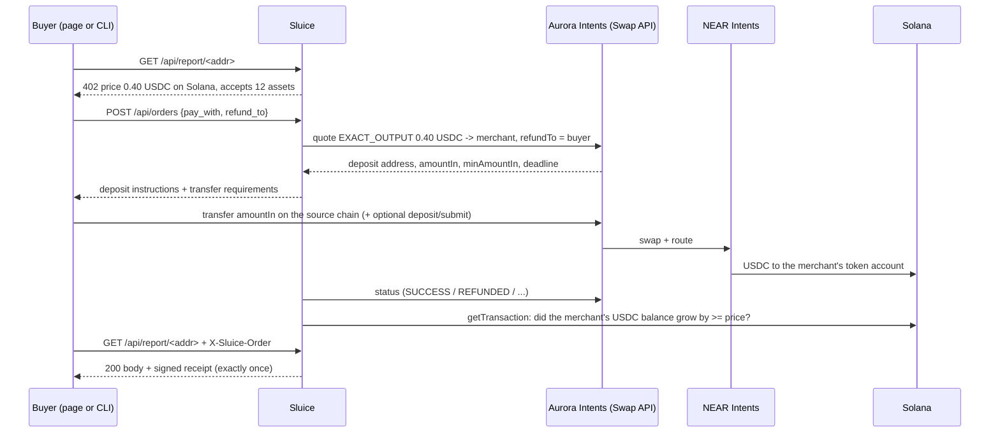

# Sluice

**Get paid in USDC on Solana, from whatever your customer holds: paid live from Base, Arbitrum, Optimism and a Tron wallet.**

## One invoice, start to finish

You sell design work and want to be paid in USDC on Solana. On the [first-run page](https://apps.swiftbotlab.workers.dev/sluice-pay/#start) you paste your Solana address, which
Sluice checks on Solana while you paste it, choose to have invoices settle straight into Kamino, and get a pay link signed by your own
wallet. Your client's money is on Base, and he has never used Solana. He opens the link, connects his wallet and signs once. Aurora
Intents swaps and bridges his USDC through NEAR Intents, and Intents Connect then runs one atomic Solana transaction that supplies the
invoice amount to Kamino with the cUSDC going to your own account and Sluice's 0.5% fee going to Sluice, in that same transaction
([live run, 5.00 USDC](https://solscan.io/tx/QzqYDzy2hh34HkzUGFwrMbVKxanc6tC4qQPxnrsiubfEVPi59dt52dSHd5zJ9UNZnAhSm5vgxHN8zDLQqrvXnxS)). Before
his wallet opens, the page decodes that transaction and refuses to sign anything else, and it marks the invoice paid only when the
transaction is on Solana. Had he paid by address instead, say with ETH on Optimism from any wallet, the same link would have
settled as plain USDC
([live run](https://solscan.io/tx/39uawZ5pSTz4jZEPv3DYZHYjxpQurRC6bvZWiac7GNkjqryzP3jpzfxKXs6e1aEgYye9WgjqHXDaYtBHUYwVJMfy)), and had he
sent too much or too little, the difference would have gone back to his own wallet on its own
([overpaid](https://basescan.org/tx/0x32c814bfd4e1c22fc1bd34d0c44228cd3ee5c70cd44b5058a35445c5a136b135),
[short](https://basescan.org/tx/0x3c2630ff73008fcf2f8956511bb954b8d97fca18f72261e38f338a0156ead7c9)). When you want the cash, one
transaction signed by your own key turns the cUSDC back into USDC plus interest (`cli/redeem_earn.py`,
[live run](https://solscan.io/tx/4XnJMN2q36Yw3mvE2S4ULGaA76hU8hp81EmnR2Rc8bXpg64qeLjdepLz4oyQHBLB86255iVu4JTr72QKN6PdgWqv)).

**That journey ran on mainnet on 4 Nov at a real size.** 5.452 USDC left Base ([deposit](https://basescan.org/tx/0x02fa3ab5d3011cd79c215a20e285539fc140038ad5dc47a28b97913aed5fdcea)) and arrived
as 5.19 USDC in the payer's own Solana account, the one Intents Connect controls for his wallet. One Intents Connect transaction then
supplied exactly 5.00 USDC to Kamino, minted 4.134567 cUSDC into the merchant's own account, paid Sluice's 0.025 USDC fee and the
0.149068 USDC Connect fee, and kept 0.015932 for the payer. 25 minutes later the merchant's own key redeemed the 4.134567 cUSDC for
5.000006 USDC. (This run's payer authorised Intents Connect with a Solana wallet, which signs ed25519, and moved its Base USDC into
its Connect account with a plain Aurora swap. The checkout's own rail does both legs from an EVM wallet in one signature, as in the
[1 Nov run](https://solscan.io/tx/558Qh7GUjopxDNUfzDib42h7CwtAhDfCvDBAAwCCAc9zNWHaayHaSq3GUuUtzN6SEWBZwr8CWsBaCvJfqFCThgrv).)

The same day a **Tron wallet** paid an invoice with one plain TRX transfer ([Tron tx](https://tronscan.org/#/transaction/eb20838a927ee6b35aa49da6062440b49f09c22d46e89bd6264d79223f28fe21)),
and 1.272 USDC reached the merchant on Solana ([settlement](https://solscan.io/tx/33HSJXY5zPhYp8g7VXAdmuLMQZmUaeTHM8VbJo1UmCA28ve3fCScSuaJQCUhYY2vYyRyURvLiXe8uGiKMdyN5zci)). With the Optimism payment, both refunds and
both redemptions, seventeen runs used real money on mainnet. The page re-checks all of them from your browser and shows, for each one,
where every unit went: the 0.30 USDC sent for a 0.25 invoice became 0.25 for the merchant, 0.037512 refunded, and 0.012488 in fees
(0.0024 refund gas, 0.010007 Solana delivery, 0.000081 Aurora's 2 bps fee and the solver's price).

The merchant receives exactly the invoiced USDC. The one exception is by design: a private payment (Confidential Intents) adds a tag
of 0.000001 to 0.000999 USDC on top of the invoice, because Aurora publishes no hashes for it and the tag is how Sluice finds the
credit on Solana.

- **Live checkout:** https://apps.swiftbotlab.workers.dev/sluice-pay/ (static page, no backend: quotes, deposit addresses and status come live from Aurora Intents, settlement is checked live on Solana mainnet)
- **Hosted pay-per-call API:** `curl -i https://sluice-api.swiftbotlab.workers.dev/api/report/9cYFzrmHRcsYzLhAWsNemzCy75ZhETn2px4MS8oDDReR` answers `402 Payment Required` with the price and a live quote ([how to pay it](#pay-per-call-the-hosted-402-api))
- **Demo video:** [youtu.be/_ZwvKTsjK_8](https://youtu.be/_ZwvKTsjK_8) (3:26, 4 Nov: one invoice start to finish with real money: merchant first run, the 5.00 USDC invoice, Base to Solana, the Intents Connect transaction decoded on Solscan with Sluice's fee, the merchant's Kamino position and its redemption, then the Tron payer, permanent page, hosted 402 API and private payments). Earlier cut: [youtu.be/OQ74RaJUksk](https://youtu.be/OQ74RaJUksk)
- Built by Swift Bot Labs for the Encode Club Solana Hackathon 2026, Aurora Intents challenge. Category: consumer/payments, with an infra rail for APIs.

## What ships

- Merchant first run in three steps, with a live preview of what the customer sees, a QR and a save-your-link screen.
- Pay links signed by the merchant's Solana wallet: change one character and the checkout refuses the link.
- 200+ assets on 30+ networks from Aurora's live list, with wallet autofill or pay by QR.
- Invoices that earn: Intents Connect settles the invoice into the merchant's own Kamino position, and the merchant redeems it with one signature.
- Permanent pay pages (Intents Deposits): one address per network, any amount, no quote.
- Private payments with Confidential Intents.
- A hosted HTTP 402 API for software buyers: delivery exactly once, after Solana confirms, with a signed receipt.
- A merchant view where every payment is a credit read from Solana, and a live proof page with every fee itemised.

## Check it in 5 minutes

No account, no wallet and no money needed.

| Time | Do this | You will see |
|---|---|---|
| 1 min | Open the [first-run flow](https://apps.swiftbotlab.workers.dev/sluice-pay/#start), paste any Solana wallet address | Three steps to a working checkout: name and payout address (checked on Solana as you paste it: token accounts, mints, 0x addresses and recovery phrases are refused), USDC or settle-to-earn, then a pay link or permanent pay page with a live preview of what the customer sees, a QR and a save-your-link screen. |
| 1 min | Open the [live demo invoice](https://apps.swiftbotlab.workers.dev/sluice-pay/#p=eyJhbXQiOiIwLjUwIiwiZXhwIjoxODAwMDEzMzY3LCJrIjoiOWNZRnpybUhSY3NZekxoQVdzTmVtekN5NzVaaEVUbjJweDRNUzhvRERSZVIiLCJyZWYiOiJkZW1vLWludm9pY2UtMTA0MiIsInMiOiJlYXJuIiwidG8iOiI5Y1lGenJtSFJjc1l6TGhBV3NOZW16Q3k3NVpoRVRuMnB4NE1TOG9ERFJlUiIsInYiOjF9.XDSG4A7YmbS97B2hAIbGSnT3aJ3sOlasUS3qWgHLkXP8qTCp9P3Iqp71OrojPLT19vcn39eOTFU0IcZZ6b3PCQ) | A merchant-signed invoice, 200+ assets on 30+ networks from Aurora's live list, a live price for whichever asset you tap. Change one character of the link: the checkout refuses it. |
| 1 min | Open the [home page](https://apps.swiftbotlab.workers.dev/sluice-pay/), go to **Live proof** (it reads the same without JavaScript) | Seventeen real mainnet runs, each with the verification stored on 4 Nov (what Aurora and Solana said, and when) and a breakdown of every fee. **Re-check all** reads Aurora and Solana again from your browser. If Aurora is slow, a row says it is showing the 4 Nov verification while the live check is pending. |
| 1 min | `curl -i https://sluice-api.swiftbotlab.workers.dev/api/report/9cYFzrmHRcsYzLhAWsNemzCy75ZhETn2px4MS8oDDReR` | The hosted 402: price 0.20 USDC on Solana, the merchant, the assets it accepts, the receipt key and a live indicative quote. [Pay it from your own wallet](#pay-per-call-the-hosted-402-api) to get the report and a signed receipt. |
| 1 min | Open a [refunded payment](https://apps.swiftbotlab.workers.dev/sluice-pay/#s=0x399E9E3B0013C1D51148F19402d9A5ecC7e0AD56) and a [paid one](https://apps.swiftbotlab.workers.dev/sluice-pay/#s=0xDF4FE7105893cB3BC78579A703b551d65eBa7c54) | Shareable records built only from Aurora and Solana data: what was sent, what came back, and the Solana check. |
| 1 min | `git clone https://github.com/swiftbotlabs/sluice-pay && cd sluice-pay && python3 cli/simulate_earn.py` | The Intents Connect transaction that settles an invoice into Kamino, run through Solana's simulator on live mainnet state. Standard library only. |
| 1 min | `node --test tests/js/core.test.mjs tests/js/proofs.test.mjs tests/js/worker.test.mjs` and, after `pip install -r requirements.txt`, `python3 -m unittest discover -s tests` | 86 checkout, proof and hosted-API tests and 63 server, CLI and parity tests, offline. They include real Intents Connect payloads, real mainnet transactions and refund records, and tampered copies of them. |

## How it meets the judging criteria

| Criterion | Where to look |
|---|---|
| **Working integration, demoed live** | Four products, each run with real money on mainnet: Swap API and Confidential Intents in the checkout, Intents Deposits on permanent pay pages, Intents Connect in the checkout and the CLI. [Seventeen mainnet runs](#live-on-mainnet-real-money-real-links) you can re-check from the page. The 402 API is [hosted](#pay-per-call-the-hosted-402-api). |
| **Removes a real cross-chain friction point** | A customer pays from what they hold, in one step, and the merchant never touches a bridge. A [permanent pay page](#permanent-pay-pages) removes even the checkout. Machine buyers get a [402 flow](#pay-per-call-the-hosted-402-api) with no human to rescue a half-finished bridge. |
| **Correct settlement and refund handling** | [Settlement and refund table](#settlement-and-refund-handling), with live refunds on mainnet for an overpaid and a short invoice, and every fee of every run itemised so the amounts add up. Provider `SUCCESS` is only a hint: delivery waits for the balance change on Solana. A short deposit can be completed in place. A failed Intents Connect step can be retried from the page, with the same order reference so it cannot pay twice. Routes under an active Aurora incident are hidden. |
| **Clean UX, no unnecessary actions** | A merchant goes from nothing to a shareable checkout in three steps, with a live preview of what the customer will see. Connect a wallet and the refund address, chain and asset fill themselves. On EVM chains, Bitcoin and Solana the QR carries the amount too, so nothing is typed. Paying with USDC already on Solana skips the bridge entirely. Mobile first. |
| **Fit and creativity** | [Invoices that earn](#invoices-that-earn): the payer's money lands in the merchant's own yield position, in one atomic transaction. Merchant-signed links. Order references you can look up on Solana. |
| **Bonus: multi-chain sources** | 200+ assets on 30+ networks, read live from Aurora's list. Real runs from Base (USDC), Arbitrum (ETH), Optimism (ETH) and Tron (TRX, a non-EVM wallet). |
| **Bonus: contract-level composability** | Intents Connect runs `refresh_reserve` and `deposit_reserve_liquidity` on Kamino (cUSDC to the merchant) and Sluice's fee transfer in one transaction, or `TransferChecked` with a reference, after the bridge lands. The page decodes the exact transaction before the wallet signs, including who receives each fee. |
| **Bonus: Confidential Intents** | The private-payment toggle, with a real Arbitrum ETH run verified on Solana. |

## The problem

A Solana app or API that wants to get paid has two bad options today: accept only Solana assets, and lose everyone whose
money sits on Base, Arbitrum, Tron or Bitcoin, or build and babysit a bridge flow per chain. Buyers have the mirror
problem: they must bridge, find gas on the right chain, and hope nothing goes wrong in between. Machine buyers (scripts,
agents, backends) have it worst: there is no human to recover a half-finished bridge.

## What Sluice does

| | |
|---|---|
| **Pay links** for people | A merchant makes a link (`amount + Solana address + reference`), optionally **signed with their Solana wallet** so nothing in it can be edited. The payer connects a wallet, or picks an asset and scans a QR (the amount is filled in where the chain's wallets support it), and watches the payment move to Solana. |
| **Permanent pay pages** (Intents Deposits) | `#a=<merchant>` gives a merchant one permanent address per network for tips, top-ups or a QR on the counter. Customers send any amount from what they hold, with no quote, wallet or form. It arrives as USDC on Solana. [More below](#permanent-pay-pages). |
| **Invoices that earn** | A signed link can say "settle into yield". The payer signs once, and one atomic Solana transaction supplies the USDC to Kamino with the cUSDC going to the merchant. [More below](#invoices-that-earn). |
| **402 pay-per-call** for software ([hosted](#pay-per-call-the-hosted-402-api)) | A Sluice API answers `402 Payment Required` with its price in USDC on Solana. A buyer creates an order, pays the quoted deposit from any supported chain, and calls again with `X-Sluice-Order`. The response comes with a **receipt signed by the server** that binds the request, the delivered bytes, the source-chain deposit and the Solana settlement. |
| **On-chain order references** (Intents Connect) | The buyer's deposit is bridged into the buyer's own Solana account (Intents Connect intermediary), which runs ONE Solana transaction paying the merchant exactly the price and carrying a **reference account derived from the order id** (the Solana Pay pattern). `getSignaturesForAddress(reference)` finds the payment for an order, from Solana alone. |
| **Private payments** (Confidential Intents) | One toggle routes the payment through Confidential Intents, so the payer's source wallet is not linkable to the Solana settlement. Sluice still verifies the settlement on Solana. |
| **Records and a merchant view** | Every payment has a shareable record (`#s=<deposit address>`, or `#c=<reference>.<merchant>` for Connect), with support details in the shape Aurora's support process asks for. `#m=<address>` is the merchant's view: balances, USDC received per day, every credit read from Solana (joined with Aurora's record where this checkout routed it, so "paid with" is the amount that reached the deposit address) and the Kamino position. A 14-day total is called complete only when the Solana history behind it proves it: it reaches past the 14 days, or back to the transaction that opened the account; a public node that returns a short list is caught and the view says the total may be incomplete. No database behind either. |
| **First run** (`#start`) | Name and payout address, then USDC or settle-to-earn, then a pay link or a permanent pay page. The address is checked on Solana while it is pasted, the customer's view is previewed live, and the last screen is the link, its QR (also as a printable PNG) and a short checklist. Signed links carry the name inside the signature. Nothing is sent to a server. |

## Permanent pay pages

Aurora's first promise for Solana apps is a persistent, any-chain deposit address. A pay link fits a fixed invoice; many merchants
need the opposite: one address that always works, for any amount. `https://apps.swiftbotlab.workers.dev/sluice-pay/#a=<solana address>` is that page.

- Addresses come from `POST /api/persistent-deposit-address`: deterministic per merchant and network, reused forever, and every EVM
  network shares one address.
- **Never shown on Aurora's word alone.** The page reads the stored record back (`/api/persistent-deposit-address-data`) and shows the
  address only if it ends at this merchant, as USDC on Solana.
- It follows Aurora's deposit-screen rules: network, asset and the number of supported assets next to the address, and transfer
  requirements directly below it, with a memo where the network needs one.
- Deposits are tracked live (`/api/persistent-deposit-status`), and each delivered payment is checked on Solana.
- **The trade-offs are on the page.** Minimum $1 ($2 on Tron), because less may never arrive. There is no automatic refund, because a failed
  deposit is retried rather than returned. So fixed prices belong on a pay link, which keeps the exact amount and the refund guarantee.

**Status: live on mainnet.** On 4 Nov a plain 1.10 USDC transfer on Base to the demo merchant's permanent address
([0xc6b89c8e...da9b](https://basescan.org/tx/0xc6b89c8e5f80eeae72b9eb7b428b035c5b907c67cac238d899f649a4541ada9b)) arrived as 1.089777 USDC
on Solana 14 seconds after Aurora saw it ([2Jhg3e1b...ksiE](https://solscan.io/tx/2Jhg3e1bBxCi3oE1BogFcvTn7bivpY3SaJbfnqqbDUzviswDczjU9Fi4WuHbLqw7EVtgqmR7qsz6hgQRHxcvksiE)),
and the [permanent page](https://apps.swiftbotlab.workers.dev/sluice-pay/#a=9cYFzrmHRcsYzLhAWsNemzCy75ZhETn2px4MS8oDDReR) lists it as delivered, checked on Solana.
We sent 1.10, not less, because Aurora's docs give $1 as the minimum from Base and a smaller deposit may get stuck. Record: [persistent-deposit-base.json](evidence/persistent-deposit-base.json).
Aurora's docs describe this API as limited to approved organisations; it answered our key, and if that changes the page says so and points to a pay link.

## Invoices that earn

Payment rails leave money idle until someone moves it. Kamino's `deposit_reserve_liquidity` only requires the destination
to be a cUSDC token account, so the depositor and the owner of the position can be different accounts. Sluice uses that:

```
Payer on Base              Intents Connect                    One atomic Solana transaction
signs once, sends USDC --> routes through NEAR Intents --> create merchant cUSDC account (if new)
                                                           refresh_reserve (Kamino)
                                                           deposit_reserve_liquidity(price)
                                                             source  = payer's intermediary USDC
                                                             cUSDC   = MERCHANT's token account
                                                             + read-only order reference account
                                                           TransferChecked(0.5% of the invoice) to Sluice
```

- The payer's intermediary never holds the position, and the order's reference travels with the deposit.
- **Sluice's fee is in the same transaction.** The payer adds 0.5% on top of the invoice (`SLUICE_FEE` in `docs/core.js`), sent with
  one `TransferChecked` to Sluice's own USDC account (owner `8b9QYitF...RFEY8`). The merchant still gets exactly the invoice. The
  checkout lists the fee before the wallet opens, and the audit refuses a fee of any other amount or to any other account
  (tests run the real 4 Nov payload and copies with the fee raised or redirected).
- **The page audits what it asks you to sign.** A wallet shows opaque text, so `auditPayload()` in `docs/core.js` checks every field
  of the signed JSON and decodes the Solana transaction inside it. It refuses anything but this: the merchant's cUSDC account, the
  invoiced amount, this order's reference, the expected reserve, and one fee within the previewed cap. The payer's Solana account is
  computed locally from the wallet address, and the deposit address is cross-checked with NEAR Intents' public record, so a compromised
  API cannot redirect the money. The Python rail has the same audit, and a parity test proves both build identical steps.
- **It is verified after, too.** `verifyEarn()` requires the Kamino deposit instruction to name the merchant's cUSDC account, this
  order's reference and the invoice amount, with the merchant's cUSDC and Kamino's USDC vault both growing in that successful
  transaction. Kamino mints whole cUSDC units, so up to 10 micro-USDC of rounding is allowed.
- **Getting the money back out:** `cli/redeem_earn.py` burns the merchant's cUSDC for USDC plus interest. It simulates first and
  sends only with `--send`.
- **Without a wallet** (paying from an exchange, or from a non-EVM chain) the same invoice settles as plain USDC. The page says so
  before the payer commits.

**Status: live on mainnet, both ways, at a real size.** On 4 Nov a 5.00 USDC invoice settled into the merchant's Kamino position with
Sluice's fee in the same transaction ([QzqYDzy2...](https://solscan.io/tx/QzqYDzy2hh34HkzUGFwrMbVKxanc6tC4qQPxnrsiubfEVPi59dt52dSHd5zJ9UNZnAhSm5vgxHN8zDLQqrvXnxS)), and the merchant redeemed it for 5.000006 USDC
([4XnJMN2q...](https://solscan.io/tx/4XnJMN2q36Yw3mvE2S4ULGaA76hU8hp81EmnR2Rc8bXpg64qeLjdepLz4oyQHBLB86255iVu4JTr72QKN6PdgWqv)). The first, smaller deposit went through the published checkout with real money on 1 Nov; on 4 Nov the merchant took that position
back out: one transaction signed by the merchant's own wallet burned the 0.124074 cUSDC and paid 0.150041 USDC (the 0.15 supplied plus interest) into
its own USDC account ([3PoYZEFg...eK35](https://solscan.io/tx/3PoYZEFgy4XaJEhKPB3gmrNjnMKNoiKtNDvekybz45JnDRxtvBm7263FPct2EiaLC75fUpsQQtqjL1yi8BtfeK35),
record: [merchant-redemption.json](evidence/merchant-redemption.json)). The merchant view lists it under Earn. To check settle-to-earn without a wallet,
`cli/simulate_earn.py` runs the same transaction through Solana's simulator on live mainnet state.

## Pay per call: the hosted 402 API

`https://sluice-api.swiftbotlab.workers.dev` sells one thing to software: a JSON snapshot of any Solana wallet (balances, token
holdings, recent activity) for 0.20 USDC on Solana, payable from any of 12 assets. It is the flow of the reference server in
`sluice/`, rebuilt for Cloudflare Workers in [`worker/`](worker/), with one Durable Object holding the order ledger in SQLite.

```bash
API=https://sluice-api.swiftbotlab.workers.dev
# 1. the price: 402 Payment Required, with the merchant, accepted assets, receipt key and a live indicative quote
curl -i $API/api/report/<solana address>
# 2. an order with your own refund address: Aurora makes an exact-output quote and a deposit address for it
curl -s -X POST $API/api/orders -H 'content-type: application/json' \
  -d '{"resource":"report","params":{"address":"<solana address>"},"pay_with":"base:USDC","refund_to":"<your 0x address>"}'
# optional: the same deposit address in NEAR Intents' public record (recipient, amount, refund address)
curl -s "https://1click.chaindefuser.com/v0/status?depositAddress=<deposit.address>"
# 3. from your own wallet, send exactly deposit.amount to deposit.address before deposit.deadline (30 minutes)
# 4. watch: AWAITING_DEPOSIT -> PROCESSING -> SETTLED, which means the USDC credit to the merchant was read on Solana
curl -s $API/api/orders/<order_id>
# 5. collect: 200, the report and an X-Sluice-Receipt header. Asking again returns the same bytes and the same receipt
curl -si $API/api/report/<solana address> -H 'X-Sluice-Order: <order_id>'
```

The headless buyer does all of this and checks the quote against NEAR Intents before it sends anything:
`python3 cli/sluice_buy.py $API/api/report/<address> --pay base:USDC --key-file payer.key --max-usd 0.30`. A receipt verifies
offline against the key published at [`/.well-known/sluice.json`](https://sluice-api.swiftbotlab.workers.dev/.well-known/sluice.json)
(`36natzvAogtKyUzTzVYd4gxoMDpVC9c4bfX3cL3bC3Qg`): save the header's JSON as `receipt.json` and the body as `report.json`, then run
`python3 cli/verify_receipt.py receipt.json --key 36natzvAogtKyUzTzVYd4gxoMDpVC9c4bfX3cL3bC3Qg --body report.json`.

It follows the app's rule: nothing is delivered until the merchant's USDC credit is read from Solana in a successful transaction
that is not older than the order, and one Solana transaction can pay for one order only. The paid work runs once per order. Orders
are rate-limited per client and in total, inputs are validated strictly, upstream calls go to fixed hosts only, and `/healthz`
probes Aurora and Solana live. The Worker holds no key that can move money: its two secrets are an Aurora integrator id and the
receipt-signing key, and the merchant is a public address. It takes the Swap API rail with public quotes; private payments and the
Intents Connect rail stay on the self-hosted server. Details in [SECURITY.md](SECURITY.md#hosted-402-api-worker).

**Status: live, paid on mainnet.** On 2026-11-04 order `ord_cZOWTyzZJkidGFJT` was paid from Base and delivered: the merchant's +0.20 USDC was read on Solana ([35PYLWiq...](https://solscan.io/tx/35PYLWiqtyAczHr3fNKqymGznSmPgCRewH78QntuC5dKZj5rw7guAymxMy3BDNDYR3uUWJXaMEURBSV6d3FnJ4NZ)), two collects returned the same bytes and the same receipt, and the receipt verifies against the published key. Record: [api-call-hosted.json](evidence/api-call-hosted.json). The refusals (unpaid 402, a different request 409, the Connect rail 400, a wrong content type 415) and the rate limit were checked on the same Worker, and the paid path is also covered by 16 offline tests built on a real mainnet transaction.

## Live on mainnet (real money, real links)

Every row below is a real payment. The page shows each one as verified on 4 Nov (the stored check: what Aurora and Solana said,
and when; also rendered into the HTML, so it reads without JavaScript), and its "Check live" buttons read Aurora's status API and
Solana mainnet again from your browser.

| Run | What it proves | Source chain deposit | Solana settlement |
|---|---|---|---|
| **5.00 USDC invoice into Kamino, with Sluice's fee, 4 Nov** | 5.452 USDC sent on Base reached the payer's own Solana account as 5.19 USDC; one Intents Connect transaction supplied exactly 5.00 USDC to Kamino, minted 4.134567 cUSDC to the merchant, paid Sluice's 0.025 USDC fee and the 0.149068 Connect fee, with the order reference attached. Record: [settle-to-earn-5usdc.json](evidence/settle-to-earn-5usdc.json) | [0x02fa3ab5...dcea](https://basescan.org/tx/0x02fa3ab5d3011cd79c215a20e285539fc140038ad5dc47a28b97913aed5fdcea) | [QzqYDzy2...XnxS](https://solscan.io/tx/QzqYDzy2hh34HkzUGFwrMbVKxanc6tC4qQPxnrsiubfEVPi59dt52dSHd5zJ9UNZnAhSm5vgxHN8zDLQqrvXnxS) |
| **Merchant redeemed the 5.00 USDC, 4 Nov** | The merchant's own wallet burned 4.134567 cUSDC and received 5.000006 USDC (5.00 plus interest) in its own account, 25 minutes later. Record: [merchant-redemption-5usdc.json](evidence/merchant-redemption-5usdc.json) | none (Solana only) | [4XnJMN2q...gWqv](https://solscan.io/tx/4XnJMN2q36Yw3mvE2S4ULGaA76hU8hp81EmnR2Rc8bXpg64qeLjdepLz4oyQHBLB86255iVu4JTr72QKN6PdgWqv) |
| **Tron wallet (non-EVM), 4 Nov** | One plain TRX transfer, 4.026148 TRX, signed by a Tron wallet to the invoice's Tron deposit address; 1.272 USDC reached the merchant on Solana 2 min 39 s later. Record: [tron-trx.json](evidence/tron-trx.json) | [eb20838a92...fe21](https://tronscan.org/#/transaction/eb20838a927ee6b35aa49da6062440b49f09c22d46e89bd6264d79223f28fe21) | [33HSJXY5...5zci](https://solscan.io/tx/33HSJXY5zPhYp8g7VXAdmuLMQZmUaeTHM8VbJo1UmCA28ve3fCScSuaJQCUhYY2vYyRyURvLiXe8uGiKMdyN5zci) |
| **Hosted 402 API, 4 Nov** | The public Worker answered 402, the buyer paid 0.2122 USDC on Base, and got the report exactly once after the 0.20 USDC credit, with a signed receipt. Record: [api-call-hosted.json](evidence/api-call-hosted.json) | [0x5e581533...4793](https://basescan.org/tx/0x5e58153312331b01866d694dbda879cf5fcdd305828fbd899daaa5cdaa8a4793) | [35PYLWiq...J4NZ](https://solscan.io/tx/35PYLWiqtyAczHr3fNKqymGznSmPgCRewH78QntuC5dKZj5rw7guAymxMy3BDNDYR3uUWJXaMEURBSV6d3FnJ4NZ) |
| **Permanent address (Intents Deposits), 4 Nov** | A plain 1.10 USDC transfer to the merchant's permanent address, with no quote and no form, arrived as 1.089777 USDC on Solana 14 s after Aurora saw it. Record: [persistent-deposit-base.json](evidence/persistent-deposit-base.json) | [0xc6b89c8e...da9b](https://basescan.org/tx/0xc6b89c8e5f80eeae72b9eb7b428b035c5b907c67cac238d899f649a4541ada9b) | [2Jhg3e1b...ksiE](https://solscan.io/tx/2Jhg3e1bBxCi3oE1BogFcvTn7bivpY3SaJbfnqqbDUzviswDczjU9Fi4WuHbLqw7EVtgqmR7qsz6hgQRHxcvksiE) |
| **Overpaid invoice, 4 Nov** | 0.30 USDC sent for a 0.25 invoice: exactly 0.25 to the merchant, and **0.037512 USDC refunded** to the payer 26 s later ([refund tx](https://basescan.org/tx/0x32c814bfd4e1c22fc1bd34d0c44228cd3ee5c70cd44b5058a35445c5a136b135)). Record: [refund-overpay-base.json](evidence/refund-overpay-base.json) | [0xcef3352b...85a4](https://basescan.org/tx/0xcef3352b2ba6fd3cf1ceae4bdcf5bbdc284525c0d783611e9afb4f5ac04b85a4) | [55V6UFtj...7eM7](https://solscan.io/tx/55V6UFtjVaCzWuK7WEDxBnS8LvXb2GLqdZFoDRXRXkbR472Rw4h9n9nWNdYJEKKYXaNxfrs9apB1WmiQVYzp7eM7) |
| **Short invoice, 4 Nov** | 0.20 USDC sent for a 0.25 invoice: `INCOMPLETE_DEPOSIT`, nothing reached the merchant, and **0.1976 USDC was refunded** to the payer after the quote deadline ([refund tx](https://basescan.org/tx/0x3c2630ff73008fcf2f8956511bb954b8d97fca18f72261e38f338a0156ead7c9)). Record: [refund-short-base.json](evidence/refund-short-base.json) | [0x40689997...93a0](https://basescan.org/tx/0x40689997843ddba14ce0ed20c401249e98dc35beed7e48730097317324f093a0) | none (refunded) |
| **Second source chain, 4 Nov** | **ETH on Optimism** paid a 0.25 USDC invoice; the 0.000021 ETH over-sent was refunded on Optimism ([refund tx](https://optimistic.etherscan.io/tx/0x996f9e7fcc848f7068a2fb2a2727e0fbf9497c88674400f2a4c4e2234ee44c80)). Record: [second-chain-optimism-eth.json](evidence/second-chain-optimism-eth.json) | [0x11333f32...8370](https://optimistic.etherscan.io/tx/0x11333f321d7893103abc3b6a212e1d0a41bbfbe6b44b12cc3635c0d3c5b58370) | [39uawZ5p...JMfy](https://solscan.io/tx/39uawZ5pSTz4jZEPv3DYZHYjxpQurRC6bvZWiac7GNkjqryzP3jpzfxKXs6e1aEgYye9WgjqHXDaYtBHUYwVJMfy) |
| **Merchant redemption, 4 Nov** | The merchant's own wallet turned its 0.124074 cUSDC back into 0.150041 USDC in its own account (`cli/redeem_earn.py`). Record: [merchant-redemption.json](evidence/merchant-redemption.json) | none (Solana only) | [3PoYZEFg...eK35](https://solscan.io/tx/3PoYZEFgy4XaJEhKPB3gmrNjnMKNoiKtNDvekybz45JnDRxtvBm7263FPct2EiaLC75fUpsQQtqjL1yi8BtfeK35) |
| **Invoice settled into Kamino** | One signature on Base through the checkout. One atomic Solana transaction supplied 0.150000 USDC to Kamino and sent 0.124074 cUSDC to the merchant's own account, with the order reference attached. Verified on Solana by the page. Record: [settle-to-earn.json](evidence/settle-to-earn.json) | [0x8e14bae0...8379](https://basescan.org/tx/0x8e14bae0049ac8491469eac7087793f988bde603b515603095175b291f298379) | [558Qh7GU...hgrv](https://solscan.io/tx/558Qh7GUjopxDNUfzDib42h7CwtAhDfCvDBAAwCCAc9zNWHaayHaSq3GUuUtzN6SEWBZwr8CWsBaCvJfqFCThgrv) |
| Success | Base USDC -> exactly 0.50 USDC to the merchant on Solana in ~40 s; the 0.002659 USDC the payer over-sent was **refunded automatically** ([refund tx](https://basescan.org/tx/0x291a1b7a6eb2af6acc8a62da930f74c9a7fb92e123a42a0d943dfb81a87fe9d4)) | [0x041579bb...6f52](https://basescan.org/tx/0x041579bb7dfcdc42b09b50b5809f746981a6b4cc8e46de22acca7e571bdd6f52) | [3uyHowgr...iSG2](https://solscan.io/tx/3uyHowgryQxRWjsC9DrxMSxFd1nvpEtq3xsrR6iGJfodAdsRC6TyVN8Zk1GgUWunsLH1j6dnz9Tz2tsMhu3xiSG2) |
| **Refund** | Payer sent 0.40 USDC for a 1.00 USDC invoice: `INCOMPLETE_DEPOSIT`, then **refunded 0.3976 USDC** to the payer's own address 30 s after the deadline ([refund tx](https://basescan.org/tx/0x7654c9edaf4e4dc2f4dbca8e23638b8570baa736d3ea1b532836b0471314071b)) | [0x926b1cce...b6ed](https://basescan.org/tx/0x926b1cce75dac5750c8cbe0364519987aa3d56d93f7bfaae6bad08fe9084b6ed) | none (refunded) |
| Private payment | **ETH on Arbitrum** -> 0.50 USDC on Solana with Confidential Intents. Aurora's status shows no hashes at all; Sluice found and verified the credit on Solana | [0x51fdff2a...564a](https://arbiscan.io/tx/0x51fdff2ad7247d23f443f9611bd333d8b7398766b57d1e6cde8983d5ac94564a) | [44GN5eYQ...B6Cj](https://solscan.io/tx/44GN5eYQhed3UHLkwCXxi2nJU53xeHot1Ff5x4YQNNZn9PG4vy8XVMhrvof6V4fJ9C2SEKCJ9ev8dAXUDZtuB6Cj) |
| Checkout page | A signed 0.15 USDC pay link opened in the checkout: the page quoted Base USDC, showed the deposit address with QR and transfer requirements, the payer sent from another wallet, and the page itself confirmed the 0.15 USDC on Solana | [0x1f0c7e5f...0852](https://basescan.org/tx/0x1f0c7e5f28450751799f7594f0ba5272b4b883c9efdd95b6c2f812017b240852) | [49Uz6rAs...VAxZV](https://solscan.io/tx/49Uz6rAsJMQEx2qcX9JdCJqSzCdbpWSKBttYaJNrjaPKjAfZ5qH6SdLr3mwAw34rucxM6hy2i91FcAJe1nVVAxZV) |
| Recorded for the demo video | Same flow on the published GitHub Pages checkout, filmed in one take: quote cross-checked with NEAR Intents, paid from another wallet, verified on Solana by the page | [0x4c578940...e7b9](https://basescan.org/tx/0x4c5789409a649fd11ed158476265c9230beda4104fa595944acfc96651a2e7b9) | [4oPn2qbt...L9Hs](https://solscan.io/tx/4oPn2qbtaHY2JiDi88BAFivHjDcHJs8QbmBDhbPezWuuZT2VVPcU7m5tb7kSwxxeY7pN6CNPj448xEZT3q7PL9Hs) |
| API call | `cli/sluice_buy.py` against a Sluice server: 402 -> order -> deposit -> settled on Solana -> report delivered with a signed receipt, re-verified by the client (~55 s) | [0x7fb64970...0708](https://basescan.org/tx/0x7fb6497012291c7da94c4998f151c4c6740cd9d0df4b2f59bc3619b8105a0708) | [45WMgPZt...cMaX](https://solscan.io/tx/45WMgPZthD5cn8RNdrEBKVDD95a8pzZ7sDrU7rZMyAabJBwDSCbZ8oHhhtgioGB4G8jQcitgypadhpTWTtURcMaX) |
| **Intents Connect rail** | `cli/sluice_buy.py --rail connect --pay arb:ETH`: ETH on Arbitrum bridged into the payer's Solana intermediary, which paid the merchant 0.15 USDC with the order's reference account `AAkRmupG...MDM6` attached; the buyer audited the exact Solana transaction before signing; delivered with a signed receipt (~50 s) | [0xb990e1e3...91fc](https://arbiscan.io/tx/0xb990e1e3b603c01bd25baa4d768c1ec3206f24c36938ca23d604fc1460fe91fc) | [3za9WNav...W9zCs](https://solscan.io/tx/3za9WNavihGUH9SxoTkA5USHp7BA6T61CA55sZXUi9X7PsowSuZeWRzS9RT8CwZgPbFZkM2np8md8Tnh7YMW9zCs) |

### Where every unit went

Every fee in every run, from Aurora's record and the Solana transaction, as the page shows it under each proof (the full split is
under "Where every unit went" on each row, and in [`docs/proofs-snapshot.json`](docs/proofs-snapshot.json) with the data each check
read and when). Amounts are in the asset that was sent. "Solana delivery" is Aurora's withdrawal fee from the quote, which includes
the rent for a token account the merchant did not have yet; "Aurora's fee and the solver's price" is what is left between the
amount swapped and what arrived. A leftover smaller than the refund fee is not refunded.

| Run | Where the money went |
|---|---|
| 5.00 USDC into Kamino, 4 Nov | 5.452 USDC sent, 0.000882 refunded and 0.0024 USDC refund gas. The 5.448718 USDC swapped became 5.19 USDC in the payer's own Solana account, after 0.257261 Solana delivery (it includes opening the payer's Solana USDC account, once) and 0.001457 Aurora's 2 bps fee and the solver's price. That account supplied 5.00 USDC to Kamino for the merchant, paid Sluice's 0.025 USDC fee, paid a 0.149068 USDC Intents Connect fee (it includes opening Sluice's fee account, once) and kept 0.015932. |
| Merchant redeemed the 5.00, 4 Nov | The merchant burned 4.134567 cUSDC and received 5.000006 USDC: the 5.00 supplied plus 0.000006 interest, for a 0.000005 SOL network fee. |
| Tron wallet, 4 Nov | 4.026148 TRX sent (plus 1.1 TRX of Tron network fees to open the deposit address), 0.013381 left over, too small to refund. The 4.012767 TRX swapped became 1.272 USDC to the merchant, after 0.010028 USDC Solana delivery and about $0.0043 Aurora's 10 bps fee and the solver's price. |
| Hosted 402 API, 4 Nov | 0.2122 sent = 0.20 to the merchant + 0.0122 USDC in fees (0.002071 left over, too small to refund, 0.010077 Solana delivery, 0.000052 Aurora's 2 bps fee and the solver's price). |
| Permanent address, 4 Nov | 1.10 sent = 1.089777 to the merchant + 0.010223 USDC for Solana delivery and Aurora's fee. |
| Overpaid invoice, 4 Nov | 0.30 sent = 0.25 to the merchant + 0.037512 refunded + 0.012488 USDC in fees (0.0024 refund gas, 0.010007 Solana delivery, 0.000081 Aurora's 2 bps fee and the solver's price). |
| Short invoice, 4 Nov | 0.20 sent = 0.1976 refunded + 0.0024 USDC refund fee. Nothing reached the merchant. |
| ETH on Optimism, 4 Nov | 0.000133368898372899 ETH sent, 0.000020982670536664 refunded and 0.0000002600774 ETH refund gas. The 0.000112126150436235 ETH swapped became 0.25 USDC to the merchant, after 0.010007 USDC Solana delivery and about $0.0009 Aurora's 10 bps fee and the solver's price. |
| Merchant redemption, 4 Nov | The merchant burned 0.124074 cUSDC and received 0.150041 USDC: the 0.15 supplied plus 0.000041 interest, for a 0.000005 SOL network fee. |
| Invoice settled into Kamino | 0.311943 USDC sent, 0.000617 refunded and 0.0024 USDC refund gas. The 0.308926 USDC swapped became 0.29883 USDC in the payer's own Solana account, after 0.010001 Solana delivery and 0.000095 Aurora's 2 bps fee and the solver's price. That account supplied 0.15 USDC to Kamino for the merchant, paid a 0.14683 USDC Intents Connect fee (it includes opening the merchant's new cUSDC account) and kept 0.002. |
| Paid from Base USDC (first payment to this merchant) | 0.773463 sent = 0.50 to the merchant + 0.002659 refunded + 0.270804 USDC in fees (0.0024 refund gas, 0.268287 Solana delivery, 0.000117 Aurora's 2 bps fee and the solver's price). |
| Refund (sent too little) | 0.40 sent = 0.3976 refunded + 0.0024 USDC refund fee. Nothing reached the merchant. |
| Private payment | 0.000222930139609761 ETH sent, 0.50 USDC to the merchant. Aurora publishes no amounts for a private payment, so the fee split is not public (the quote listed 45 bps of app fees). |
| Checkout page | 0.161561 sent = 0.15 to the merchant + 0.011561 USDC in fees (0.001531 left over, too small to refund, 0.010006 Solana delivery, 0.000024 Aurora's 2 bps fee and the solver's price). |
| Recorded for the demo video | 0.161535 sent = 0.15 to the merchant + 0.011535 USDC in fees (0.001495 left over, too small to refund, 0.009983 Solana delivery, 0.000057 Aurora's 2 bps fee and the solver's price). |
| Intents Connect rail | 0.000071028266525738 ETH sent, 0.00000067162053299 left over, too small to refund. The 0.000070356645992748 ETH swapped became 0.153555 USDC in the payer's own Solana account, after 0.009983 USDC Solana delivery and about $0.0003 Aurora's 10 bps fee and the solver's price. That account paid the merchant 0.15 USDC with the order reference, paid a 0.001556 USDC Intents Connect fee and kept 0.001999. |
| API call | 0.414193 sent = 0.40 to the merchant + 0.001639 refunded + 0.012554 USDC in fees (0.0024 refund gas, 0.010028 Solana delivery, 0.000126 Aurora's 2 bps fee and the solver's price). |

Raw records (quotes, status timelines, the signed receipt and the delivered body) are in [`evidence/`](evidence/).
Verify the API-call receipt yourself:

```bash
python3 cli/verify_receipt.py evidence/api-call-paid-by-cli.json \
  --key xr1EUADeCKSEEWYAHr4GhTt6L8WPQe67iQjD2yztam2 --body evidence/api-call-delivered-body.json
```

## How it works



### Settlement and refund handling

| Situation | What Sluice does |
|---|---|
| Buyer sends exactly the quote | `PENDING_DEPOSIT -> PROCESSING -> SUCCESS`, then Sluice reads the destination transaction from Solana and checks the merchant's USDC token-account delta before marking the order `SETTLED`. |
| Buyer sends too little | Aurora reports `INCOMPLETE_DEPOSIT`. The page shows exactly what is missing and rebuilds the QR for that remainder, so the payment can be finished before the deadline. Otherwise Aurora refunds to the buyer's own `refundTo` (shown with the refund tx). Live runs above (29 Oct and 4 Nov). |
| Buyer sends too much | Swap executes, the merchant gets exactly the invoice, and the excess is refunded to `refundTo` after settlement. Live runs above: 0.037512 USDC back on Base, 0.000021 ETH back on Optimism. The record and the checkout show the refund transaction, wherever Aurora lists it. |
| Nobody pays | Order expires; nothing moved. |
| Route fails | `FAILED` / `REFUNDED` surfaced with refund details. An Intents Connect failure leaves funds in the buyer's own intermediary account, and the page offers to run the Solana step again (steps-only, same order reference, nothing new leaves the wallet). It first checks that the order has not already settled. |
| Aurora reports an incident | Affected assets and chains leave the list. An incident on Solana delivery pauses payments instead of letting funds get stuck (`/api/incidents`). |
| Buyer abandons a Connect payment | The next attempt clears it with an explicit signature, but only after Aurora confirms nothing was deposited for it. |
| Buyer closes the tab | The order is kept in the browser and polling resumes on return. Each payment also has a shareable record link. |
| Provider says SUCCESS but the merchant did not receive the full amount | **Not delivered.** The order stays `PROCESSING` until Solana shows the credit (unit-tested). |
| The same Solana transaction is presented for two orders | Rejected: a settlement signature can be credited once (`UNIQUE` in the ledger, unit-tested). |
| Private payment (no provider hashes) | The invoice amount is tagged with 1-999 micro-USDC (0.000001 to 0.000999 USDC), which the payer pays and the merchant receives on top of the invoice; Sluice scans the merchant's token account for that exact credit after the order was created. The tag is the only case where the merchant does not receive exactly the invoice, and the checkout says so before the payer picks it. |
| Client retries a paid request | The paid work runs once; retries get the same stored bytes and receipt. |

Refunds always go to the payer's own address on the paying chain (`refundTo`), never to the merchant.

## How Solana powers it

- **Settlement asset and account.** Every payment settles as SPL USDC (`EPjF...Dt1v`) in the merchant's associated token
  account. Sluice derives that account (PDA) itself and treats the Solana ledger as the source of truth.
- **Independent verification.** Before anything is delivered, Sluice fetches the settlement transaction over Solana RPC
  and checks `postTokenBalances - preTokenBalances` for the merchant and the USDC mint, that the transaction succeeded,
  and that it is not older than the order. The browser checkout does the same check client-side.
- **Programmable settlement via Intents Connect.** The Connect rail runs Solana instructions from the payer's MPC-controlled
  intermediary right after the bridge lands: `ATA CreateIdempotent` (only if the merchant has no USDC account yet),
  `TransferChecked` of exactly the price with a read-only reference account derived from the order id, in one atomic
  transaction. Looking up that reference on Solana returns the payment for the order.
- **Solana keys for trust.** Pay links are signed with the merchant's Solana ed25519 key and verified in the browser
  (WebCrypto Ed25519). Delivery receipts are ed25519 signatures with a Solana-format key published at
  `/.well-known/sluice.json`.

## Aurora Intents products used

| Product | Where |
|---|---|
| Swap API: `GET /api/tokens`, `POST /api/quote` (EXACT_OUTPUT, refundTo, deadline), `POST /api/deposit/submit`, `GET /api/status` | `sluice/aurora.py`, `docs/app.js` |
| Confidential Intents (`confidentiality: "advanced"`) | private-payment toggle, `--confidential` |
| Intents Connect: intermediary, bridge-in execution with Solana steps, ERC-191 signing, submit, deposit record, polling, delete | `docs/app.js` + `docs/core.js` (browser), `sluice/connect.py`, `--rail connect` (CLI) |
| Live routes: `GET /api/incidents`, `GET /api/transactions` | `docs/app.js` |
| Intents Deposits, persistent addresses: create, address data, deposit status | `docs/app.js`, `docs/core.js`, `#a=<merchant>` |

**The buyer does not have to trust the seller.** `cli/sluice_buy.py` pins token contracts and decimals, prices the
payment with the public NEAR Intents token list, and looks the deposit address up in the public NEAR Intents status API
before sending anything: recipient, amount, origin asset, refund address and amountIn must match. On the Connect rail it
decodes the exact Solana transaction it is asked to authorise and refuses anything except paying the merchant the price,
this order's reference account and one service fee of at most 0.02 USDC (tested against the real mainnet payload and edited copies).

Following Aurora's integration guidance: 429s honour `Retry-After` with jitter, the token list is cached, status polling
runs every 6 s per order (the server's background poller makes at most one status call every 3 s in total), the
deposit address is never shown without network, asset, exact amount, minimum, deadline and the refund rule next to it.

## Run it

Requirements: Python 3.10+, `pip install -r requirements.txt` (PyNaCl for receipts; eth-account only for the buyer CLI).

```bash
git clone https://github.com/swiftbotlabs/sluice-pay && cd sluice-pay
python3 -m venv .venv && . .venv/bin/activate && pip install -r requirements.txt

# 1) tests (offline, no network, no keys)
python3 -m unittest discover -s tests -v
node --test tests/js/core.test.mjs tests/js/proofs.test.mjs tests/js/worker.test.mjs

# 2) a server selling a Solana wallet report for 0.40 USDC
cat > sluice.env <<'EOF'
AURORA_API_KEY=<your key from https://studio.aurora.dev>
MERCHANT=<your Solana address, receives USDC>
RECEIPT_SECRET_B58=<base58 ed25519 secret for receipts; NOT your treasury key>
SLUICE_PRICE_RAW=400000
EOF
chmod 600 sluice.env
python3 -m sluice.server --config sluice.env --port 8402

# 3) pay for a call from Base USDC (key file: one hex EVM key, chmod 600)
python3 cli/sluice_buy.py http://127.0.0.1:8402/api/report/<solana-address> \
  --pay base:USDC --key-file payer.key --max-usd 0.60
# --rail connect                       settle through Intents Connect (pay + order reference in one Solana tx)
# --confidential --accept-unverifiable-quote   private payment (quote cannot be cross-checked publicly; loss capped by --max-usd)

# 4) signed pay link for the checkout page (--earn settles into Kamino)
python3 cli/make_link.py --key-file merchant.key --amount 25.00 --ref invoice-1042 --name "Demo Shop" --earn

# 5) settle-to-earn: prove it on live mainnet state (no keys), then turn a position back into USDC
python3 cli/simulate_earn.py
python3 cli/redeem_earn.py --key-file merchant.key          # dry run; add --send to do it
```

The checkout page is plain HTML/JS in `docs/` (served by the server at `/` and by GitHub Pages). It needs no backend.

## Project layout

```
sluice/aurora.py    Swap API client (validation, quote echo checks, 429 handling)
sluice/connect.py   Intents Connect bridge-in, Solana steps (pay + reference, Kamino earn), payload audits
sluice/soltx.py     Small Solana transaction builder + mainnet simulation
sluice/solana.py    base58, PDA/ATA derivation, RPC, settlement verification, reference lookups
sluice/engine.py    order state machine, refunds, settlement claim, exactly-once delivery
sluice/store.py     SQLite ledger with UNIQUE deposit address and settlement signature
sluice/receipts.py  ed25519 receipts and signed pay links
sluice/server.py    HTTP API (402 flow), rate limits, strict input handling
cli/                sluice_buy.py (headless buyer), verify_receipt.py, make_link.py, simulate_earn.py, redeem_earn.py
docs/core.js        the checkout's money logic: PDAs, steps, payload audit, payment URIs, Solana checks (no DOM, no network)
docs/app.js         the checkout: wallets, routes, status, records, merchant view (GitHub Pages)
docs/proofs.js      the 17 live proofs: rows, checks and fee arithmetic, shared by the page and tools/snapshot_proofs.mjs
docs/proofs-snapshot.json  the stored verification of all 17 runs (what each check read, and when)
tools/render_static.mjs    writes that stored verification into index.html, so the proof list reads without JavaScript
worker/             the hosted 402 API (Cloudflare Worker + Durable Object ledger), same money rules via docs/core.js
tests/              offline unit, HTTP, browser-core and Python/JS parity tests
evidence/           records of the mainnet runs
```

## Business model

- **Settle-to-earn invoices: 0.5%, live.** The payer adds 0.5% on top of the invoice, inside the very Solana transaction that settles
  into Kamino, to Sluice's own account. On the 4 Nov 5.00 USDC run that was 0.025 USDC
  ([transaction](https://solscan.io/tx/QzqYDzy2hh34HkzUGFwrMbVKxanc6tC4qQPxnrsiubfEVPi59dt52dSHd5zJ9UNZnAhSm5vgxHN8zDLQqrvXnxS), instruction 7). A card rail charges a merchant about 3%; here the merchant pays nothing
  and gets exactly the invoice, in a yield position.
- **Plain-USDC invoices:** Aurora shares fees with integrators (60% of the fee set on an API key, up to 500 bps, configured in Aurora's
  portal, no code change). This page's key runs at Aurora's floor today (2 bps on stables, 10 bps otherwise, all to Aurora), so plain
  invoices earn Sluice nothing yet; at 30 bps a customer would pay 0.30% and Sluice would keep 0.18%.
- **Pay-per-call APIs:** the hosted 402 API sells data for USDC; the same rail can carry a per-call margin.

## Builder notes for the Aurora team

- **Intents Connect + SPL Memo on Solana.** Our first design wrote the order id with the SPL Memo program inside the
  Connect steps. The bridge leg settled, but the Solana operation was never broadcast (`OPERATION_FAILED` after about
  21 minutes, twice: once as a bridge-in, once as a steps-only retry), with no 400 at create time. The same transfer with
  a read-only reference account instead of the Memo instruction settled in about 25 seconds. If Memo is intentionally not
  allowed by the relayer, a validation error at create time would save integrators a lot of time. Details in
  `evidence/intents-connect.json`.
- **`dry` previews overstate first-time fees.** On a merchant with no cUSDC account the dry preview said 0.195 USDC and the real
  create said 0.1475 USDC, so an app that blocks on a dry preview can refuse a wallet that has enough.
- **A signed execution blocks the next one.** After an abandoned attempt a new create answers `409`, so an app has to read the open
  execution, check that nothing was deposited, and delete it. The checkout does this.
- **Dry quotes with an `INTENTS` refund do not apply the route minimum.** Bitcoin priced cleanly that way and then failed as
  "Amount is too low" with an `ORIGIN_CHAIN` refund, so previews here use a same-chain sample address where the format is known.
- **Refund hashes moved between status fields.** In October a refund appeared as the second entry of `originChainTxHashes`; on 4 Nov
  it appeared inside `destinationChainTxHashes`, next to the Solana signature. An app that treats every destination hash as a Solana
  settlement can try to verify an EVM refund hash on Solana. Sluice sorts hashes by what they are (a Solana signature decodes to 64 bytes).
- **Confidential quotes are invisible to public status APIs**, so a buyer cannot cross-check a server-made private quote.
  Sluice's CLI therefore asks for explicit consent (`--accept-unverifiable-quote`) for private payments.

## Honest notes

- Built from scratch during the hackathon (first commit 29 Oct 2026). No earlier code.
- The mainnet runs were paid by us: from scripted demo wallets in October, and from our own treasury wallet on 4 Nov, always to our own demo merchant. Refunds went back to the wallet that paid.
- Cross-chain minimums apply: about 0.14 USDC out from Base, about 6.5 USDC out from Bitcoin. The page shows the
  route's minimum when an invoice is too small, before anything is typed.
- The first payment to a merchant that has never held the settlement token costs more: about 0.25 USDC on the Swap route
  and about 0.15 USDC on the Connect route (Solana token-account rent). Both show it in the quote, and later payments do not pay it.
- Not every listed asset has a route at every moment. Each is quoted live, and the page says so when one has none.
- The checkout connects EVM wallets only. Solana wallets pay by QR, other chains by address or QR. The 4 Nov Tron run paid a Swap API
  deposit address with a plain TRX transfer, exactly as a Tron wallet or exchange would from the QR.
- The checkout's history lists payments made through this page's API key.
- The Aurora API key in `docs/app.js` is a public integrator key by Aurora's design (it is meant to ship in web pages).
  The server uses its own, separate key.
- The server in `sluice/` is a reference implementation: single process, SQLite, binds to 127.0.0.1. The hosted 402 API in `worker/` is
  the public one; it takes the Swap API rail with public quotes only.
- The hosted API's demo merchant is our own wallet, so a judge who pays it pays us 0.20 USDC for a wallet report. The deposit goes
  through Aurora's quote for that order. Anything sent above the quote comes back to the refund address minus the refund gas, and
  a leftover smaller than the refund gas is not refunded (see the fee table above).

See [SECURITY.md](SECURITY.md). License: MIT.
