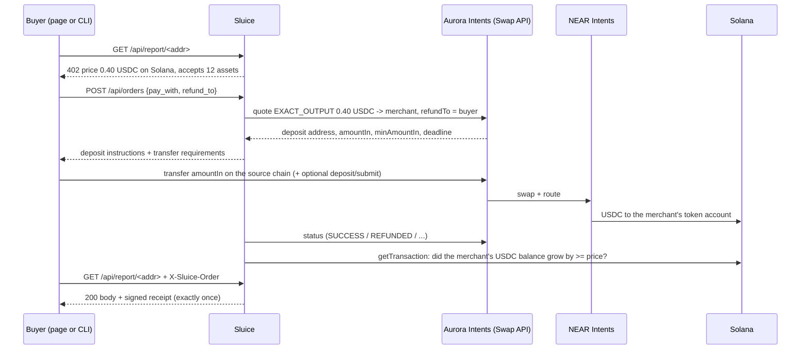

# Sluice

**Get paid in USDC on Solana by anyone, from any chain.** Sluice is a checkout link and a pay-per-call API rail for
Solana merchants. The buyer pays with what they already hold (USDC on Base, ETH on Arbitrum, USDT on Tron, BTC and
more). Aurora Intents, powered by NEAR Intents, routes it, and the merchant receives exactly the invoiced USDC in
their Solana wallet. Nothing is delivered until Sluice has seen that USDC land on Solana itself. If a payment comes up
short, expires or fails, the buyer is refunded to their own address automatically.

- **Live checkout:** https://swiftbotlab.github.io/sluice-pay/ (static page; quotes, deposit addresses and status come live from Aurora Intents, settlement is checked live on Solana mainnet)
- **Demo video:** _coming with the final submission_
- Built by Swift Bot Labs for the Encode Club Solana Hackathon 2026, Aurora Intents track.

## The problem

A Solana app or API that wants to get paid has two bad options today: accept only Solana assets (and lose everyone whose
money sits on Base, Arbitrum, Tron or Bitcoin), or build and babysit a bridge flow per chain. Buyers have the mirror
problem: they must bridge, find gas on the right chain, and hope nothing goes wrong in between. Machine buyers (scripts,
agents, backends) have it worst: there is no human to recover a half-finished bridge.

## What Sluice does

| | |
|---|---|
| **Pay links** for people | A merchant makes a link (`amount + Solana address + reference`), optionally **signed with their Solana wallet** so the amount and address cannot be edited. The payer picks one of 12 assets on 9 networks, gets a deposit address with a QR code and Aurora's transfer-requirements block, pays from any wallet, and watches the payment move to Solana. |
| **402 pay-per-call** for software | A Sluice API answers `402 Payment Required` with its price in USDC on Solana. A buyer creates an order, pays the quoted deposit from any supported chain, and calls again with `X-Sluice-Order`. The response comes with a **receipt signed by the server** that binds the request, the delivered bytes, the source-chain deposit and the Solana settlement. |
| **On-chain order references** (Intents Connect) | With `--rail connect`, the buyer's deposit is bridged into the buyer's own Solana account (Intents Connect intermediary), which then runs ONE Solana transaction paying the merchant exactly the price and carrying a **reference account derived from the order id** (the Solana Pay pattern). The merchant finds the payment for an order with `getSignaturesForAddress(reference)`, from Solana alone. |
| **Private payments** (Confidential Intents) | One toggle routes the payment through Confidential Intents, so the payer's source wallet is not linkable to the Solana settlement. Sluice still verifies the settlement on Solana. |

## Live on mainnet (real money, real links)

Every row below is a real payment made while building Sluice. The checkout page can re-check each one live
(the "Check live" buttons read Aurora's status API and Solana mainnet from your browser).

| Run | What it proves | Source chain deposit | Solana settlement |
|---|---|---|---|
| Success | Base USDC -> exactly 0.50 USDC to the merchant on Solana in ~40 s; the 0.002659 USDC the payer over-sent was **refunded automatically** ([refund tx](https://basescan.org/tx/0x291a1b7a6eb2af6acc8a62da930f74c9a7fb92e123a42a0d943dfb81a87fe9d4)) | [0x041579bb...6f52](https://basescan.org/tx/0x041579bb7dfcdc42b09b50b5809f746981a6b4cc8e46de22acca7e571bdd6f52) | [3uyHowgr...iSG2](https://solscan.io/tx/3uyHowgryQxRWjsC9DrxMSxFd1nvpEtq3xsrR6iGJfodAdsRC6TyVN8Zk1GgUWunsLH1j6dnz9Tz2tsMhu3xiSG2) |
| **Refund** | Payer sent 0.40 USDC for a 1.00 USDC invoice: `INCOMPLETE_DEPOSIT`, then **refunded 0.3976 USDC** to the payer's own address 30 s after the deadline ([refund tx](https://basescan.org/tx/0x7654c9edaf4e4dc2f4dbca8e23638b8570baa736d3ea1b532836b0471314071b)) | [0x926b1cce...b6ed](https://basescan.org/tx/0x926b1cce75dac5750c8cbe0364519987aa3d56d93f7bfaae6bad08fe9084b6ed) | none (refunded) |
| Private payment | **ETH on Arbitrum** -> 0.50 USDC on Solana with Confidential Intents. Aurora's status shows no hashes at all; Sluice found and verified the credit on Solana | [0x51fdff2a...564a](https://arbiscan.io/tx/0x51fdff2ad7247d23f443f9611bd333d8b7398766b57d1e6cde8983d5ac94564a) | [44GN5eYQ...B6Cj](https://solscan.io/tx/44GN5eYQhed3UHLkwCXxi2nJU53xeHot1Ff5x4YQNNZn9PG4vy8XVMhrvof6V4fJ9C2SEKCJ9ev8dAXUDZtuB6Cj) |
| Checkout page | A signed 0.15 USDC pay link opened in the checkout: the page quoted Base USDC, showed the deposit address with QR and transfer requirements, the payer sent from another wallet, and the page itself confirmed the 0.15 USDC on Solana | [0x1f0c7e5f...0852](https://basescan.org/tx/0x1f0c7e5f28450751799f7594f0ba5272b4b883c9efdd95b6c2f812017b240852) | [49Uz6rAs...VAxZV](https://solscan.io/tx/49Uz6rAsJMQEx2qcX9JdCJqSzCdbpWSKBttYaJNrjaPKjAfZ5qH6SdLr3mwAw34rucxM6hy2i91FcAJe1nVVAxZV) |
| Recorded for the demo video | Same flow on the published GitHub Pages checkout, filmed in one take: quote cross-checked with NEAR Intents, paid from another wallet, verified on Solana by the page | [0x4c578940...e7b9](https://basescan.org/tx/0x4c5789409a649fd11ed158476265c9230beda4104fa595944acfc96651a2e7b9) | [4oPn2qbt...L9Hs](https://solscan.io/tx/4oPn2qbtaHY2JiDi88BAFivHjDcHJs8QbmBDhbPezWuuZT2VVPcU7m5tb7kSwxxeY7pN6CNPj448xEZT3q7PL9Hs) |
| API call | `cli/sluice_buy.py` against a Sluice server: 402 -> order -> deposit -> settled on Solana -> report delivered with a signed receipt, re-verified by the client (~55 s) | [0x7fb64970...0708](https://basescan.org/tx/0x7fb6497012291c7da94c4998f151c4c6740cd9d0df4b2f59bc3619b8105a0708) | [45WMgPZt...cMaX](https://solscan.io/tx/45WMgPZthD5cn8RNdrEBKVDD95a8pzZ7sDrU7rZMyAabJBwDSCbZ8oHhhtgioGB4G8jQcitgypadhpTWTtURcMaX) |
| **Intents Connect rail** | `cli/sluice_buy.py --rail connect --pay arb:ETH`: ETH on Arbitrum bridged into the payer's Solana intermediary, which paid the merchant 0.15 USDC with the order's reference account `AAkRmupG...MDM6` attached; the buyer audited the exact Solana transaction before signing; delivered with a signed receipt (~50 s) | [0xb990e1e3...91fc](https://arbiscan.io/tx/0xb990e1e3b603c01bd25baa4d768c1ec3206f24c36938ca23d604fc1460fe91fc) | [3za9WNav...W9zCs](https://solscan.io/tx/3za9WNavihGUH9SxoTkA5USHp7BA6T61CA55sZXUi9X7PsowSuZeWRzS9RT8CwZgPbFZkM2np8md8Tnh7YMW9zCs) |

Raw records (quotes, status timelines, the signed receipt and the delivered body) are in [`evidence/`](evidence/).
Verify the API-call receipt yourself:

```bash
python3 cli/verify_receipt.py evidence/api-call-paid-by-cli.json \
  --key xr1EUADeCKSEEWYAHr4GhTt6L8WPQe67iQjD2yztam2 --body evidence/api-call-delivered-body.json
```

## How it works



### Settlement and refund handling

| Situation | What Sluice does |
|---|---|
| Buyer sends exactly the quote | `PENDING_DEPOSIT -> PROCESSING -> SUCCESS`, then Sluice reads the destination transaction from Solana and checks the merchant's USDC token-account delta before marking the order `SETTLED`. |
| Buyer sends too little | Aurora reports `INCOMPLETE_DEPOSIT`; the buyer is told to top up before the deadline. After the deadline Aurora refunds to the buyer's own `refundTo` (shown with the refund tx). Live run above. |
| Buyer sends too much | Swap executes, the excess is refunded to `refundTo` after settlement (live run above). |
| Nobody pays | Order expires; nothing moved. |
| Route fails | `FAILED` / `REFUNDED` surfaced with refund details. Intents Connect failures leave funds in the buyer's own intermediary account, recoverable by the buyer. |
| Provider says SUCCESS but the merchant did not receive the full amount | **Not delivered.** The order stays `PROCESSING` until Solana shows the credit (unit-tested). |
| The same Solana transaction is presented for two orders | Rejected: a settlement signature can be credited once (`UNIQUE` in the ledger, unit-tested). |
| Private payment (no provider hashes) | The invoice amount is tagged with 1-999 micro-USDC; Sluice scans the merchant's token account for that exact credit after the order was created. |
| Client retries a paid request | The paid work runs once; retries get the same stored bytes and receipt. |

Refunds always go to the payer's own address on the paying chain (`refundTo`), never to the merchant.

## How Solana powers it

- **Settlement asset and account.** Every payment settles as SPL USDC (`EPjF...Dt1v`) in the merchant's associated token
  account. Sluice derives that account (PDA) itself and treats the Solana ledger as the source of truth.
- **Independent verification.** Before anything is delivered, Sluice fetches the settlement transaction over Solana RPC
  and checks `postTokenBalances - preTokenBalances` for the merchant and the USDC mint, that the transaction succeeded,
  and that it is not older than the order. The browser checkout does the same check client-side.
- **Programmable settlement via Intents Connect.** The Connect rail runs Solana instructions from the payer's MPC-controlled
  intermediary right after the bridge lands: `ATA CreateIdempotent` (only if the merchant has no USDC account yet),
  `TransferChecked` of exactly the price with a read-only reference account derived from the order id, in one atomic
  transaction. Looking up that reference on Solana returns the payment for the order.
- **Solana keys for trust.** Pay links are signed with the merchant's Solana ed25519 key and verified in the browser
  (WebCrypto Ed25519). Delivery receipts are ed25519 signatures with a Solana-format key published at
  `/.well-known/sluice.json`.

## Aurora Intents products used

| Product | Where |
|---|---|
| Swap API: `GET /api/tokens`, `POST /api/quote` (EXACT_OUTPUT, refundTo, deadline), `POST /api/deposit/submit`, `GET /api/status` | `sluice/aurora.py`, `docs/app.js` |
| Confidential Intents (`confidentiality: "advanced"`) | private-payment toggle, `--confidential` |
| Intents Connect: intermediary, bridge-in execution with Solana steps, ERC-191 signing, submit, deposit record, polling | `sluice/connect.py`, `--rail connect` |

**The buyer does not have to trust the seller.** `cli/sluice_buy.py` pins token contracts and decimals, prices the
payment with the public NEAR Intents token list, and looks the deposit address up in the public NEAR Intents status API
before sending anything: recipient, amount, origin asset, refund address and amountIn must match. On the Connect rail it
decodes the exact Solana transaction it is asked to authorise and refuses anything except paying the merchant the price,
this order's reference account and one service fee of at most 0.02 USDC (tested against the real mainnet payload and edited copies).

Following Aurora's integration guidance: 429s honour `Retry-After` with jitter, the token list is cached, status polling
runs every 6 s per order (the server's background poller makes at most one status call every 3 s in total), the
deposit address is never shown without network, asset, exact amount, minimum, deadline and the refund rule next to it.

## Run it

Requirements: Python 3.10+, `pip install -r requirements.txt` (PyNaCl for receipts; eth-account only for the buyer CLI).

```bash
git clone https://github.com/swiftbotlab/sluice-pay && cd sluice-pay
python3 -m venv .venv && . .venv/bin/activate && pip install -r requirements.txt

# 1) tests (offline, no network, no keys)
python3 -m unittest discover -s tests -v

# 2) a server selling a Solana wallet report for 0.40 USDC
cat > sluice.env <<'EOF'
AURORA_API_KEY=<your key from https://studio.aurora.dev>
MERCHANT=<your Solana address, receives USDC>
RECEIPT_SECRET_B58=<base58 ed25519 secret for receipts; NOT your treasury key>
SLUICE_PRICE_RAW=400000
EOF
chmod 600 sluice.env
python3 -m sluice.server --config sluice.env --port 8402

# 3) pay for a call from Base USDC (key file: one hex EVM key, chmod 600)
python3 cli/sluice_buy.py http://127.0.0.1:8402/api/report/<solana-address> \
  --pay base:USDC --key-file payer.key --max-usd 0.60
# --rail connect                       settle through Intents Connect (pay + order reference in one Solana tx)
# --confidential --accept-unverifiable-quote   private payment (quote cannot be cross-checked publicly; loss capped by --max-usd)

# 4) signed pay link for the checkout page
python3 cli/make_link.py --key-file merchant.key --amount 25.00 --ref invoice-1042
```

The checkout page is plain HTML/JS in `docs/` (served by the server at `/` and by GitHub Pages). It needs no backend.

## Project layout

```
sluice/aurora.py    Swap API client (validation, quote echo checks, 429 handling)
sluice/connect.py   Intents Connect bridge-in + Solana receipt steps + ERC-191 signing
sluice/solana.py    base58, PDA/ATA derivation, RPC, settlement verification, reference lookups
sluice/engine.py    order state machine, refunds, settlement claim, exactly-once delivery
sluice/store.py     SQLite ledger with UNIQUE deposit address and settlement signature
sluice/receipts.py  ed25519 receipts and signed pay links
sluice/server.py    HTTP API (402 flow), rate limits, strict input handling
cli/                sluice_buy.py (headless buyer), verify_receipt.py, make_link.py
docs/               the checkout page (GitHub Pages)
tests/              offline unit and HTTP tests
evidence/           records of the mainnet runs
```

## Builder notes for the Aurora team

- **Intents Connect + SPL Memo on Solana.** Our first design wrote the order id with the SPL Memo program inside the
  Connect steps. The bridge leg settled, but the Solana operation was never broadcast (`OPERATION_FAILED` after about
  21 minutes, twice: once as a bridge-in, once as a steps-only retry), with no 400 at create time. The same transfer with
  a read-only reference account instead of the Memo instruction settled in about 25 seconds. If Memo is intentionally not
  allowed by the relayer, a validation error at create time would save integrators a lot of time. Details in
  `evidence/intents-connect.json`.
- **Confidential quotes are invisible to public status APIs**, so a buyer cannot cross-check a server-made private quote.
  Sluice's CLI therefore asks for explicit consent (`--accept-unverifiable-quote`) for private payments.

## Honest notes

- Built from scratch during the hackathon (first commit 29 Oct 2026). No earlier code.
- Cross-chain minimums apply: about 0.14 USDC out from Base, about 6.7 USDC out from Bitcoin. The page shows the
  route's minimum when an invoice is too small.
- The first payment to a merchant that has never held USDC costs ~0.27 USDC more (Solana token-account rent, charged
  by the route and shown in the quote).
- The Aurora API key in `docs/app.js` is a public integrator key by Aurora's design (it is meant to ship in web pages).
  The server uses its own, separate key.
- The server is a reference implementation: single process, SQLite, binds to 127.0.0.1. Put a TLS proxy in front to expose it.

See [SECURITY.md](SECURITY.md). License: MIT.
