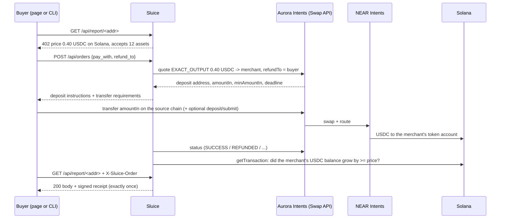

# Sluice

**Get paid in USDC on Solana by anyone, from any chain.** Sluice is a checkout link and a pay-per-call API rail for
Solana merchants. The buyer pays with what they already hold (USDC on Base, ETH on Arbitrum, USDT on Tron, BTC and
200 more assets). Aurora Intents, powered by NEAR Intents, routes it. The merchant receives exactly the invoiced USDC,
or has it supplied straight into Kamino, and nothing counts until Sluice has seen it land on Solana itself. On a pay link, a
payment that comes up short or expires goes back to the buyer automatically, and every failure path says exactly where the money is.

- **Live checkout:** https://apps.swiftbotlab.workers.dev/sluice-pay/ (static page, no backend: quotes, deposit addresses and status come live from Aurora Intents, settlement is checked live on Solana mainnet)
- **Demo video:** [youtu.be/fWHiFb4OXe8](https://youtu.be/fWHiFb4OXe8)
- Built by Swift Bot Labs for the Encode Club Solana Hackathon 2026, Aurora Intents challenge. Category: consumer/payments, with an infra rail for APIs.

## Check it in 5 minutes

No account, no wallet and no money needed.

| Time | Do this | You will see |
|---|---|---|
| 1 min | Open the [first-run flow](https://apps.swiftbotlab.workers.dev/sluice-pay/#start), paste any Solana wallet address | Three steps to a working checkout: name and payout address (checked on Solana as you paste it: token accounts, mints, 0x addresses and recovery phrases are refused), USDC or settle-to-earn, then a pay link or permanent pay page with a live preview of what the customer sees, a QR and a save-your-link screen. |
| 1 min | Open the [live demo invoice](https://apps.swiftbotlab.workers.dev/sluice-pay/#p=eyJhbXQiOiIwLjUwIiwiZXhwIjoxODAwMDEzMzY3LCJrIjoiOWNZRnpybUhSY3NZekxoQVdzTmVtekN5NzVaaEVUbjJweDRNUzhvRERSZVIiLCJyZWYiOiJkZW1vLWludm9pY2UtMTA0MiIsInMiOiJlYXJuIiwidG8iOiI5Y1lGenJtSFJjc1l6TGhBV3NOZW16Q3k3NVpoRVRuMnB4NE1TOG9ERFJlUiIsInYiOjF9.XDSG4A7YmbS97B2hAIbGSnT3aJ3sOlasUS3qWgHLkXP8qTCp9P3Iqp71OrojPLT19vcn39eOTFU0IcZZ6b3PCQ) | A merchant-signed invoice, 202 assets on 34 networks from Aurora's live list, a live price for whichever asset you tap. Change one character of the link: the checkout refuses it. |
| 1 min | Open the [home page](https://apps.swiftbotlab.workers.dev/sluice-pay/), go to **Live proof**, press **Re-check all** | Eight real mainnet payments re-verified from your browser, against Aurora and Solana, right now. |
| 1 min | Open a [refunded payment](https://apps.swiftbotlab.workers.dev/sluice-pay/#s=0x399E9E3B0013C1D51148F19402d9A5ecC7e0AD56) and a [paid one](https://apps.swiftbotlab.workers.dev/sluice-pay/#s=0xDF4FE7105893cB3BC78579A703b551d65eBa7c54) | Shareable records built only from Aurora and Solana data: what was sent, what came back, and the Solana check. |
| 1 min | `git clone https://github.com/swiftbotlabs/sluice-pay && cd sluice-pay && python3 cli/simulate_earn.py` | The Intents Connect transaction that settles an invoice into Kamino, run through Solana's simulator on live mainnet state. Standard library only. |
| 1 min | Open the [merchant view](https://apps.swiftbotlab.workers.dev/sluice-pay/#m=9cYFzrmHRcsYzLhAWsNemzCy75ZhETn2px4MS8oDDReR) of the demo merchant | Balances, USDC received per day, every payment with its Solana transaction and record, and the Kamino position, all read live from Solana. |
| 1 min | `node --test tests/js/core.test.mjs` and, after `pip install -r requirements.txt`, `python3 -m unittest discover -s tests` | 39 checkout tests and 53 server, CLI and parity tests, offline. They include real Intents Connect payloads, real mainnet transactions, and tampered copies of them. |

## How it meets the judging criteria

| Criterion | Where to look |
|---|---|
| **Working integration, demoed live** | All three products: Swap API and Confidential Intents in the checkout, Intents Deposits on permanent pay pages, Intents Connect in the checkout and the CLI. [Eight mainnet payments](#live-on-mainnet-real-money-real-links) you can re-check from the page. |
| **Removes a real cross-chain friction point** | A customer pays from what they hold, in one step, and the merchant never touches a bridge. A [permanent pay page](#permanent-pay-pages) removes even the checkout. Machine buyers get a [402 flow](#what-sluice-does) with no human to rescue a half-finished bridge. |
| **Correct settlement and refund handling** | [Settlement and refund table](#settlement-and-refund-handling), with a real refund on mainnet. Provider `SUCCESS` is only a hint: delivery waits for the balance change on Solana. A short deposit can be completed in place. A failed Intents Connect step can be retried from the page, with the same order reference so it cannot pay twice. Routes under an active Aurora incident are hidden. |
| **Clean UX, no unnecessary actions** | A merchant goes from nothing to a shareable checkout in three steps, with a live preview of what the customer will see. Connect a wallet and the refund address, chain and asset fill themselves. On EVM chains, Bitcoin and Solana the QR carries the amount too, so nothing is typed. Paying with USDC already on Solana skips the bridge entirely. Mobile first. |
| **Fit and creativity** | [Invoices that earn](#invoices-that-earn): the payer's money lands in the merchant's own yield position, in one atomic transaction. Merchant-signed links. Order references you can look up on Solana. |
| **Bonus: multi-chain sources** | 202 assets on 34 networks, read live from Aurora's list. Real runs from Base and Arbitrum. |
| **Bonus: contract-level composability** | Intents Connect runs `refresh_reserve` and `deposit_reserve_liquidity` on Kamino, or `TransferChecked` with a reference, after the bridge lands. The page decodes the exact transaction before the wallet signs. |
| **Bonus: Confidential Intents** | The private-payment toggle, with a real Arbitrum ETH run verified on Solana. |

## The problem

A Solana app or API that wants to get paid has two bad options today: accept only Solana assets, and lose everyone whose
money sits on Base, Arbitrum, Tron or Bitcoin, or build and babysit a bridge flow per chain. Buyers have the mirror
problem: they must bridge, find gas on the right chain, and hope nothing goes wrong in between. Machine buyers (scripts,
agents, backends) have it worst: there is no human to recover a half-finished bridge.

## What Sluice does

| | |
|---|---|
| **Pay links** for people | A merchant makes a link (`amount + Solana address + reference`), optionally **signed with their Solana wallet** so nothing in it can be edited. The payer connects a wallet, or picks an asset and scans a QR (the amount is filled in where the chain's wallets support it), and watches the payment move to Solana. |
| **Permanent pay pages** (Intents Deposits) | `#a=<merchant>` gives a merchant one permanent address per network for tips, top-ups or a QR on the counter. Customers send any amount from what they hold, with no quote, wallet or form. It arrives as USDC on Solana. [More below](#permanent-pay-pages). |
| **Invoices that earn** | A signed link can say "settle into yield". The payer signs once, and one atomic Solana transaction supplies the USDC to Kamino with the cUSDC going to the merchant. [More below](#invoices-that-earn). |
| **402 pay-per-call** for software | A Sluice API answers `402 Payment Required` with its price in USDC on Solana. A buyer creates an order, pays the quoted deposit from any supported chain, and calls again with `X-Sluice-Order`. The response comes with a **receipt signed by the server** that binds the request, the delivered bytes, the source-chain deposit and the Solana settlement. |
| **On-chain order references** (Intents Connect) | The buyer's deposit is bridged into the buyer's own Solana account (Intents Connect intermediary), which runs ONE Solana transaction paying the merchant exactly the price and carrying a **reference account derived from the order id** (the Solana Pay pattern). `getSignaturesForAddress(reference)` finds the payment for an order, from Solana alone. |
| **Private payments** (Confidential Intents) | One toggle routes the payment through Confidential Intents, so the payer's source wallet is not linkable to the Solana settlement. Sluice still verifies the settlement on Solana. |
| **Records and a merchant view** | Every payment has a shareable record (`#s=<deposit address>`, or `#c=<reference>.<merchant>` for Connect), with support details in the shape Aurora's support process asks for. `#m=<address>` is the merchant's view: balances, USDC received per day, every credit read from Solana (joined with Aurora's record where this checkout routed it) and the Kamino position. No database behind either. |
| **First run** (`#start`) | Name and payout address, then USDC or settle-to-earn, then a pay link or a permanent pay page. The address is checked on Solana while it is pasted, the customer's view is previewed live, and the last screen is the link, its QR (also as a printable PNG) and a short checklist. Signed links carry the name inside the signature. Nothing is sent to a server. |

## Permanent pay pages

Aurora's first promise for Solana apps is a persistent, any-chain deposit address. A pay link fits a fixed invoice; many merchants
need the opposite: one address that always works, for any amount. `https://apps.swiftbotlab.workers.dev/sluice-pay/#a=<solana address>` is that page.

- Addresses come from `POST /api/persistent-deposit-address`: deterministic per merchant and network, reused forever, and every EVM
  network shares one address.
- **Never shown on Aurora's word alone.** The page reads the stored record back (`/api/persistent-deposit-address-data`) and shows the
  address only if it ends at this merchant, as USDC on Solana.
- It follows Aurora's deposit-screen rules: network, asset and the number of supported assets next to the address, and transfer
  requirements directly below it, with a memo where the network needs one.
- Deposits are tracked live (`/api/persistent-deposit-status`), and each delivered payment is checked on Solana.
- **The trade-offs are on the page.** Minimum $1 ($2 on Tron), because less may never arrive. There is no automatic refund, because a failed
  deposit is retried rather than returned. So fixed prices belong on a pay link, which keeps the exact amount and the refund guarantee.

**Status, plainly:** addresses are live on mainnet for all listed networks and verified against Aurora's records; the tracking and Solana
check are tested offline. No money has been sent through one yet. Aurora's docs describe this API as limited to approved organisations; it answered our key, and if that
changes the page says so and points to a pay link.

## Invoices that earn

Payment rails leave money idle until someone moves it. Kamino's `deposit_reserve_liquidity` only requires the destination
to be a cUSDC token account, so the depositor and the owner of the position can be different accounts. Sluice uses that:

```
Payer on Base              Intents Connect                    One atomic Solana transaction
signs once, sends USDC --> routes through NEAR Intents --> create merchant cUSDC account (if new)
                                                           refresh_reserve (Kamino)
                                                           deposit_reserve_liquidity(price)
                                                             source  = payer's intermediary USDC
                                                             cUSDC   = MERCHANT's token account
                                                             + read-only order reference account
```

- The payer's intermediary never holds the position, and the order's reference travels with the deposit.
- **The page audits what it asks you to sign.** A wallet shows opaque text, so `auditPayload()` in `docs/core.js` checks every field
  of the signed JSON and decodes the Solana transaction inside it. It refuses anything but this: the merchant's cUSDC account, the
  invoiced amount, this order's reference, the expected reserve, and one fee within the previewed cap. The payer's Solana account is
  computed locally from the wallet address, and the deposit address is cross-checked with NEAR Intents' public record, so a compromised
  API cannot redirect the money. The Python rail has the same audit, and a parity test proves both build identical steps.
- **It is verified after, too.** `verifyEarn()` requires the Kamino deposit instruction to name the merchant's cUSDC account, this
  order's reference and the invoice amount, with the merchant's cUSDC and Kamino's USDC vault both growing in that successful
  transaction. Kamino mints whole cUSDC units, so up to 10 micro-USDC of rounding is allowed.
- **Getting the money back out:** `cli/redeem_earn.py` burns the merchant's cUSDC for USDC plus interest. It simulates first and
  sends only with `--send`.
- **Without a wallet** (paying from an exchange, or from a non-EVM chain) the same invoice settles as plain USDC. The page says so
  before the payer commits.

**Status: live on mainnet.** The run above went through the published checkout with real money. To check it without a wallet, `cli/simulate_earn.py`
runs the same transaction through Solana's simulator on live mainnet state. `cli/redeem_earn.py` has been simulated against a real cUSDC holder, not yet run live.

## Live on mainnet (real money, real links)

Every row below is a real payment. The checkout page can re-check each one live
(the "Check live" buttons read Aurora's status API and Solana mainnet from your browser).

| Run | What it proves | Source chain deposit | Solana settlement |
|---|---|---|---|
| **Invoice settled into Kamino** | One signature on Base through the checkout. One atomic Solana transaction supplied 0.150000 USDC to Kamino and sent 0.124074 cUSDC to the merchant's own account, with the order reference attached. Verified on Solana by the page. Record: [settle-to-earn.json](evidence/settle-to-earn.json) | [0x8e14bae0...8379](https://basescan.org/tx/0x8e14bae0049ac8491469eac7087793f988bde603b515603095175b291f298379) | [558Qh7GU...hgrv](https://solscan.io/tx/558Qh7GUjopxDNUfzDib42h7CwtAhDfCvDBAAwCCAc9zNWHaayHaSq3GUuUtzN6SEWBZwr8CWsBaCvJfqFCThgrv) |
| Success | Base USDC -> exactly 0.50 USDC to the merchant on Solana in ~40 s; the 0.002659 USDC the payer over-sent was **refunded automatically** ([refund tx](https://basescan.org/tx/0x291a1b7a6eb2af6acc8a62da930f74c9a7fb92e123a42a0d943dfb81a87fe9d4)) | [0x041579bb...6f52](https://basescan.org/tx/0x041579bb7dfcdc42b09b50b5809f746981a6b4cc8e46de22acca7e571bdd6f52) | [3uyHowgr...iSG2](https://solscan.io/tx/3uyHowgryQxRWjsC9DrxMSxFd1nvpEtq3xsrR6iGJfodAdsRC6TyVN8Zk1GgUWunsLH1j6dnz9Tz2tsMhu3xiSG2) |
| **Refund** | Payer sent 0.40 USDC for a 1.00 USDC invoice: `INCOMPLETE_DEPOSIT`, then **refunded 0.3976 USDC** to the payer's own address 30 s after the deadline ([refund tx](https://basescan.org/tx/0x7654c9edaf4e4dc2f4dbca8e23638b8570baa736d3ea1b532836b0471314071b)) | [0x926b1cce...b6ed](https://basescan.org/tx/0x926b1cce75dac5750c8cbe0364519987aa3d56d93f7bfaae6bad08fe9084b6ed) | none (refunded) |
| Private payment | **ETH on Arbitrum** -> 0.50 USDC on Solana with Confidential Intents. Aurora's status shows no hashes at all; Sluice found and verified the credit on Solana | [0x51fdff2a...564a](https://arbiscan.io/tx/0x51fdff2ad7247d23f443f9611bd333d8b7398766b57d1e6cde8983d5ac94564a) | [44GN5eYQ...B6Cj](https://solscan.io/tx/44GN5eYQhed3UHLkwCXxi2nJU53xeHot1Ff5x4YQNNZn9PG4vy8XVMhrvof6V4fJ9C2SEKCJ9ev8dAXUDZtuB6Cj) |
| Checkout page | A signed 0.15 USDC pay link opened in the checkout: the page quoted Base USDC, showed the deposit address with QR and transfer requirements, the payer sent from another wallet, and the page itself confirmed the 0.15 USDC on Solana | [0x1f0c7e5f...0852](https://basescan.org/tx/0x1f0c7e5f28450751799f7594f0ba5272b4b883c9efdd95b6c2f812017b240852) | [49Uz6rAs...VAxZV](https://solscan.io/tx/49Uz6rAsJMQEx2qcX9JdCJqSzCdbpWSKBttYaJNrjaPKjAfZ5qH6SdLr3mwAw34rucxM6hy2i91FcAJe1nVVAxZV) |
| Recorded for the demo video | Same flow on the published GitHub Pages checkout, filmed in one take: quote cross-checked with NEAR Intents, paid from another wallet, verified on Solana by the page | [0x4c578940...e7b9](https://basescan.org/tx/0x4c5789409a649fd11ed158476265c9230beda4104fa595944acfc96651a2e7b9) | [4oPn2qbt...L9Hs](https://solscan.io/tx/4oPn2qbtaHY2JiDi88BAFivHjDcHJs8QbmBDhbPezWuuZT2VVPcU7m5tb7kSwxxeY7pN6CNPj448xEZT3q7PL9Hs) |
| API call | `cli/sluice_buy.py` against a Sluice server: 402 -> order -> deposit -> settled on Solana -> report delivered with a signed receipt, re-verified by the client (~55 s) | [0x7fb64970...0708](https://basescan.org/tx/0x7fb6497012291c7da94c4998f151c4c6740cd9d0df4b2f59bc3619b8105a0708) | [45WMgPZt...cMaX](https://solscan.io/tx/45WMgPZthD5cn8RNdrEBKVDD95a8pzZ7sDrU7rZMyAabJBwDSCbZ8oHhhtgioGB4G8jQcitgypadhpTWTtURcMaX) |
| **Intents Connect rail** | `cli/sluice_buy.py --rail connect --pay arb:ETH`: ETH on Arbitrum bridged into the payer's Solana intermediary, which paid the merchant 0.15 USDC with the order's reference account `AAkRmupG...MDM6` attached; the buyer audited the exact Solana transaction before signing; delivered with a signed receipt (~50 s) | [0xb990e1e3...91fc](https://arbiscan.io/tx/0xb990e1e3b603c01bd25baa4d768c1ec3206f24c36938ca23d604fc1460fe91fc) | [3za9WNav...W9zCs](https://solscan.io/tx/3za9WNavihGUH9SxoTkA5USHp7BA6T61CA55sZXUi9X7PsowSuZeWRzS9RT8CwZgPbFZkM2np8md8Tnh7YMW9zCs) |

Raw records (quotes, status timelines, the signed receipt and the delivered body) are in [`evidence/`](evidence/).
Verify the API-call receipt yourself:

```bash
python3 cli/verify_receipt.py evidence/api-call-paid-by-cli.json \
  --key xr1EUADeCKSEEWYAHr4GhTt6L8WPQe67iQjD2yztam2 --body evidence/api-call-delivered-body.json
```

## How it works



### Settlement and refund handling

| Situation | What Sluice does |
|---|---|
| Buyer sends exactly the quote | `PENDING_DEPOSIT -> PROCESSING -> SUCCESS`, then Sluice reads the destination transaction from Solana and checks the merchant's USDC token-account delta before marking the order `SETTLED`. |
| Buyer sends too little | Aurora reports `INCOMPLETE_DEPOSIT`. The page shows exactly what is missing and rebuilds the QR for that remainder, so the payment can be finished before the deadline. Otherwise Aurora refunds to the buyer's own `refundTo` (shown with the refund tx). Live run above. |
| Buyer sends too much | Swap executes, the excess is refunded to `refundTo` after settlement (live run above). |
| Nobody pays | Order expires; nothing moved. |
| Route fails | `FAILED` / `REFUNDED` surfaced with refund details. An Intents Connect failure leaves funds in the buyer's own intermediary account, and the page offers to run the Solana step again (steps-only, same order reference, nothing new leaves the wallet). It first checks that the order has not already settled. |
| Aurora reports an incident | Affected assets and chains leave the list. An incident on Solana delivery pauses payments instead of letting funds get stuck (`/api/incidents`). |
| Buyer abandons a Connect payment | The next attempt clears it with an explicit signature, but only after Aurora confirms nothing was deposited for it. |
| Buyer closes the tab | The order is kept in the browser and polling resumes on return. Each payment also has a shareable record link. |
| Provider says SUCCESS but the merchant did not receive the full amount | **Not delivered.** The order stays `PROCESSING` until Solana shows the credit (unit-tested). |
| The same Solana transaction is presented for two orders | Rejected: a settlement signature can be credited once (`UNIQUE` in the ledger, unit-tested). |
| Private payment (no provider hashes) | The invoice amount is tagged with 1-999 micro-USDC; Sluice scans the merchant's token account for that exact credit after the order was created. |
| Client retries a paid request | The paid work runs once; retries get the same stored bytes and receipt. |

Refunds always go to the payer's own address on the paying chain (`refundTo`), never to the merchant.

## How Solana powers it

- **Settlement asset and account.** Every payment settles as SPL USDC (`EPjF...Dt1v`) in the merchant's associated token
  account. Sluice derives that account (PDA) itself and treats the Solana ledger as the source of truth.
- **Independent verification.** Before anything is delivered, Sluice fetches the settlement transaction over Solana RPC
  and checks `postTokenBalances - preTokenBalances` for the merchant and the USDC mint, that the transaction succeeded,
  and that it is not older than the order. The browser checkout does the same check client-side.
- **Programmable settlement via Intents Connect.** The Connect rail runs Solana instructions from the payer's MPC-controlled
  intermediary right after the bridge lands: `ATA CreateIdempotent` (only if the merchant has no USDC account yet),
  `TransferChecked` of exactly the price with a read-only reference account derived from the order id, in one atomic
  transaction. Looking up that reference on Solana returns the payment for the order.
- **Solana keys for trust.** Pay links are signed with the merchant's Solana ed25519 key and verified in the browser
  (WebCrypto Ed25519). Delivery receipts are ed25519 signatures with a Solana-format key published at
  `/.well-known/sluice.json`.

## Aurora Intents products used

| Product | Where |
|---|---|
| Swap API: `GET /api/tokens`, `POST /api/quote` (EXACT_OUTPUT, refundTo, deadline), `POST /api/deposit/submit`, `GET /api/status` | `sluice/aurora.py`, `docs/app.js` |
| Confidential Intents (`confidentiality: "advanced"`) | private-payment toggle, `--confidential` |
| Intents Connect: intermediary, bridge-in execution with Solana steps, ERC-191 signing, submit, deposit record, polling, delete | `docs/app.js` + `docs/core.js` (browser), `sluice/connect.py`, `--rail connect` (CLI) |
| Live routes: `GET /api/incidents`, `GET /api/transactions` | `docs/app.js` |
| Intents Deposits, persistent addresses: create, address data, deposit status | `docs/app.js`, `docs/core.js`, `#a=<merchant>` |

**The buyer does not have to trust the seller.** `cli/sluice_buy.py` pins token contracts and decimals, prices the
payment with the public NEAR Intents token list, and looks the deposit address up in the public NEAR Intents status API
before sending anything: recipient, amount, origin asset, refund address and amountIn must match. On the Connect rail it
decodes the exact Solana transaction it is asked to authorise and refuses anything except paying the merchant the price,
this order's reference account and one service fee of at most 0.02 USDC (tested against the real mainnet payload and edited copies).

Following Aurora's integration guidance: 429s honour `Retry-After` with jitter, the token list is cached, status polling
runs every 6 s per order (the server's background poller makes at most one status call every 3 s in total), the
deposit address is never shown without network, asset, exact amount, minimum, deadline and the refund rule next to it.

## Run it

Requirements: Python 3.10+, `pip install -r requirements.txt` (PyNaCl for receipts; eth-account only for the buyer CLI).

```bash
git clone https://github.com/swiftbotlabs/sluice-pay && cd sluice-pay
python3 -m venv .venv && . .venv/bin/activate && pip install -r requirements.txt

# 1) tests (offline, no network, no keys)
python3 -m unittest discover -s tests -v
node --test tests/js/core.test.mjs

# 2) a server selling a Solana wallet report for 0.40 USDC
cat > sluice.env <<'EOF'
AURORA_API_KEY=<your key from https://studio.aurora.dev>
MERCHANT=<your Solana address, receives USDC>
RECEIPT_SECRET_B58=<base58 ed25519 secret for receipts; NOT your treasury key>
SLUICE_PRICE_RAW=400000
EOF
chmod 600 sluice.env
python3 -m sluice.server --config sluice.env --port 8402

# 3) pay for a call from Base USDC (key file: one hex EVM key, chmod 600)
python3 cli/sluice_buy.py http://127.0.0.1:8402/api/report/<solana-address> \
  --pay base:USDC --key-file payer.key --max-usd 0.60
# --rail connect                       settle through Intents Connect (pay + order reference in one Solana tx)
# --confidential --accept-unverifiable-quote   private payment (quote cannot be cross-checked publicly; loss capped by --max-usd)

# 4) signed pay link for the checkout page (--earn settles into Kamino)
python3 cli/make_link.py --key-file merchant.key --amount 25.00 --ref invoice-1042 --name "Demo Shop" --earn

# 5) settle-to-earn: prove it on live mainnet state (no keys), then turn a position back into USDC
python3 cli/simulate_earn.py
python3 cli/redeem_earn.py --key-file merchant.key          # dry run; add --send to do it
```

The checkout page is plain HTML/JS in `docs/` (served by the server at `/` and by GitHub Pages). It needs no backend.

## Project layout

```
sluice/aurora.py    Swap API client (validation, quote echo checks, 429 handling)
sluice/connect.py   Intents Connect bridge-in, Solana steps (pay + reference, Kamino earn), payload audits
sluice/soltx.py     Small Solana transaction builder + mainnet simulation
sluice/solana.py    base58, PDA/ATA derivation, RPC, settlement verification, reference lookups
sluice/engine.py    order state machine, refunds, settlement claim, exactly-once delivery
sluice/store.py     SQLite ledger with UNIQUE deposit address and settlement signature
sluice/receipts.py  ed25519 receipts and signed pay links
sluice/server.py    HTTP API (402 flow), rate limits, strict input handling
cli/                sluice_buy.py (headless buyer), verify_receipt.py, make_link.py, simulate_earn.py, redeem_earn.py
docs/core.js        the checkout's money logic: PDAs, steps, payload audit, payment URIs, Solana checks (no DOM, no network)
docs/app.js         the checkout: wallets, routes, status, records, merchant view (GitHub Pages)
tests/              offline unit, HTTP, browser-core and Python/JS parity tests
evidence/           records of the mainnet runs
```

## Business model

Aurora shares fees with integrators: 60% of the fee set on an API key goes to the integrator, up to 500 bps, with no code
change. This page's key runs at Aurora's floor today, so Sluice takes nothing. At 30 bps a merchant's customers would pay
0.30% and Sluice would keep 0.18%, which suits a checkout that is cheaper than a card rail.

## Builder notes for the Aurora team

- **Intents Connect + SPL Memo on Solana.** Our first design wrote the order id with the SPL Memo program inside the
  Connect steps. The bridge leg settled, but the Solana operation was never broadcast (`OPERATION_FAILED` after about
  21 minutes, twice: once as a bridge-in, once as a steps-only retry), with no 400 at create time. The same transfer with
  a read-only reference account instead of the Memo instruction settled in about 25 seconds. If Memo is intentionally not
  allowed by the relayer, a validation error at create time would save integrators a lot of time. Details in
  `evidence/intents-connect.json`.
- **`dry` previews overstate first-time fees.** On a merchant with no cUSDC account the dry preview said 0.195 USDC and the real
  create said 0.1475 USDC, so an app that blocks on a dry preview can refuse a wallet that has enough.
- **A signed execution blocks the next one.** After an abandoned attempt a new create answers `409`, so an app has to read the open
  execution, check that nothing was deposited, and delete it. The checkout does this.
- **Dry quotes with an `INTENTS` refund do not apply the route minimum.** Bitcoin priced cleanly that way and then failed as
  "Amount is too low" with an `ORIGIN_CHAIN` refund, so previews here use a same-chain sample address where the format is known.
- **Confidential quotes are invisible to public status APIs**, so a buyer cannot cross-check a server-made private quote.
  Sluice's CLI therefore asks for explicit consent (`--accept-unverifiable-quote`) for private payments.

## Honest notes

- Built from scratch during the hackathon (first commit 29 Oct 2026). No earlier code.
- Cross-chain minimums apply: about 0.14 USDC out from Base, about 6.5 USDC out from Bitcoin. The page shows the
  route's minimum when an invoice is too small, before anything is typed.
- The first payment to a merchant that has never held the settlement token costs more: about 0.25 USDC on the Swap route
  and about 0.15 USDC on the Connect route (Solana token-account rent). Both show it in the quote, and later payments do not pay it.
- Not every listed asset has a route at every moment. Each is quoted live, and the page says so when one has none.
- The checkout connects EVM wallets only. Solana wallets pay by QR, other chains by address or QR.
- The checkout's history lists payments made through this page's API key.
- The Aurora API key in `docs/app.js` is a public integrator key by Aurora's design (it is meant to ship in web pages).
  The server uses its own, separate key.
- The server is a reference implementation: single process, SQLite, binds to 127.0.0.1. Put a TLS proxy in front to expose it.

See [SECURITY.md](SECURITY.md). License: MIT.
